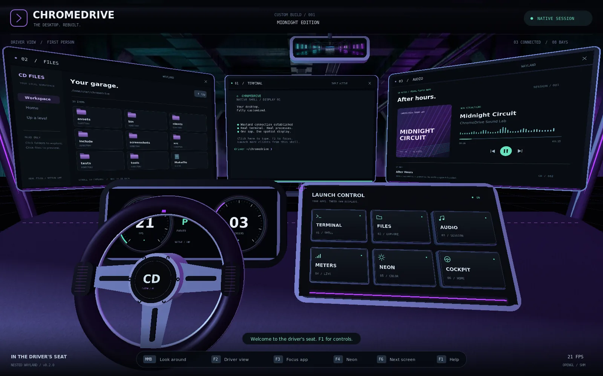
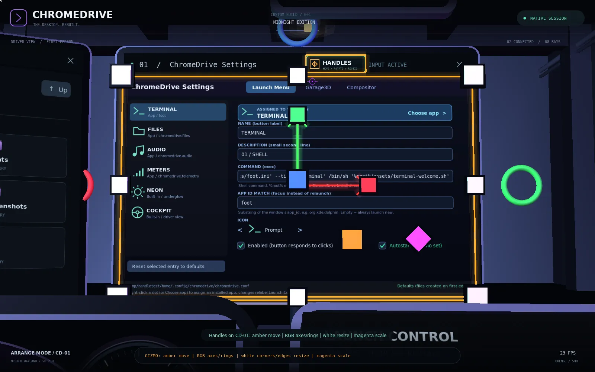

# ChromeDrive



A native Wayland compositor styled like a pimped-out car cockpit. You sit in the
driver's seat, first-person. Dashboard buttons — picked with real 3D raycasts,
not HTML — launch genuine Wayland applications, and **each app gets its own
spatial monitor** mounted around the windshield.

The cockpit now belongs to a **spline-built electric hover car**. Its modeled
82 kWh skateboard pack, dual drive units, power electronics, charging hardware,
and thermal loop can be inspected in an exterior systems cutaway. Fixed-step
120 Hz dynamics make the whole car/cockpit/monitor rig drive through an off-street
home garage campus and a deterministic infinite 3D city—without pretending to
simulate wheels. Streamed 80 m districts contain local streets, alleys, avenues,
boulevards, covered tunnels, public squares, parking courts, parks, and other
enterable garages. Meta+A engages a deterministic garage-to-garage/northern-district
autopilot using the same throttle,
brake and steering inputs as manual driving. F7 switches the physical steering
wheel and driving keys between Wayland-client input and hover-car control; F8
cycles driver, smooth exterior-concept, and EV-systems cameras, while F9
switches between properly aligned driver and passenger seats. The shared seats,
controls and door trim sit forward beside the doorway. Meta+O opens and closes real
full-height hinged door assemblies—from the sill through the side glass and
roof rail, including interior trim and door-mounted displays—and F6 toggles
the monitor Arrange editor. Applications
use fixed, slide-up, slide-out, or flip-down mounts built into the windshield,
dashboard, doors, roof, and rear deck. A separate Wayland instrument client
lives behind the steering wheel, with a transparent live HUD on the windshield.
See [`docs/vehicle-and-remote.md`](docs/vehicle-and-remote.md).

This is a real compositor: it implements `wl_compositor`, `wl_subcompositor`,
`xdg-shell` (toplevels + popups), `wl_seat` (pointer + xkbcommon keyboard,
plus SDL touchscreen `wl_touch` in `--windowed` mode),
`wl_data_device_manager` (in-session clipboard), `zxdg_decoration_manager_v1`,
`zwp_linux_dmabuf_v1` (GPU zero-copy buffer import), and one `wl_output`
global per virtual monitor. Any well-behaved Wayland client can connect to it
and will appear on its own screen.

It runs four ways (`--backend headless|windowed|fbdev|drm`; the old flags remain
as aliases):

- **`--headless` (default): no X server, no window, anywhere.** The GL context
  is a surfaceless EGL context (no window system at all); a per-frame
  `glReadPixels` feeds an embedded [libvncserver](https://libvnc.org/) RFB
  server, so the whole cockpit — compositor and every client window inside it
  — is visible over VNC. `tools/viewer` bridges that to a browser via
  websockify + noVNC.
- **`--fbdev [DEVICE]`: direct Linux framebuffer output** (`/dev/fb0` by
  default). It reuses the same surfaceless-EGL renderer, does one
  `glReadPixels` per frame, and converts/blits that RGBA frame into the
  framebuffer's current packed truecolor mode. This is **CPU readback/blit to
  the kernel's existing fb mode, not DRM/KMS GPU scanout**. By default it
  adopts the current kernel mode (phase 1 behavior). Opt-in modesetting via
  `FBIOPUT_VSCREENINFO` is available with `--fbdev-modeset` (uses the
  configured render size) or `--fbdev-mode WIDTHxHEIGHT[@BPP]` (explicit
  size/BPP). The original mode is restored on exit. Asynchronous local evdev
  input (keyboard, mouse, touchscreen) is enabled by default; use
  `--no-fbdev-evdev` (or `--no-evdev`) to disable. `--fbdev-grab-input` opts in to `EVIOCGRAB`
  (warns about VT/console lockout). Explicit device restriction via
  `--fbdev-input-device PATH` (repeatable, max 8). `--fbdev-vnc-mirror` adds
  an explicit, loopback-only RFB control/output companion sharing the same
  readback.
- **`--drm [DEVICE]`: direct DRM/KMS + GBM/EGL scanout** (`/dev/dri/card0` by
  default). It selects a connected connector and compatible CRTC, retains the
  current valid mode or chooses the preferred mode, and presents with
  event-driven KMS page flips and modifier-aware framebuffer registration—no
  CPU readback/blit. `--drm-mode WIDTHxHEIGHT` requires an exact advertised
  mode. The previous CRTC and its original connected/cloned connector set are
  restored on exit when still available.
  This path needs DRM-master/KMS access and a GBM `XRGB8888` EGL configuration;
  it does not silently fall back to fbdev. Local input is the same asynchronous
  evdev path as fbdev (`--no-evdev`, `--input-device`, and `--grab-input` are
  generic aliases for the corresponding fbdev-named options).
- **`--windowed`: a real SDL2/GLX window on an X server**, kept only as a
  local dev/debug path with eyes on a real display. `zwp_linux_dmabuf_v1` is
  **not** advertised here — see "GPU / dma-buf" below for why.

## What's real vs. simulated

- **Real**: the Wayland protocol implementation, OpenGL scene, 3D raycast
  picking for buttons/screens, input routing to actual client processes, the
  terminal (`foot`) and the bundled demo modes (Files, Audio UI, host Meters,
  and the live EV instrument cluster — all genuine `wl_shm` clients speaking
  real Wayland, source in `clients/demo.c`), the shared GL renderer with its
  headless EGL+VNC, fbdev readback/blit, and direct DRM/KMS outputs, and the
  `zwp_linux_dmabuf_v1` GPU-import code path (real EGLImage calls — see
  caveat below). The garage beyond the windshield is real 3D geometry now,
  not the flat `assets/garage.webp` backdrop quad it used to be — see
  “Garage3D” below.
- **Limitations in this build**: no layer-shell or Xwayland. DRM/KMS currently
  drives one connected connector/CRTC with primary-framebuffer page flips, not
  an atomic multi-plane/output manager or a VT-session broker. fbdev remains a
  CPU-readback/blit path even though it can modeset and accept local input.
  There are eight general app mounts plus one dedicated instrument-cluster
  output; buffers capped at 16 MiB/64 MiB total per surface for safety; single
  input seat and no tablet; touchscreen `wl_touch` is fed by SDL finger events
  in `--windowed` mode or direct evdev devices in fbdev/DRM, while RFB remains
  a single pointer because RFB has no multitouch events to forward.
- The "Audio" app is explicitly a UI/interaction demo — it does not play audio.
  The fixed instrument cluster is a real Wayland client showing shared EV
  telemetry. The separately launched `telemetry` demo mode reads real
  `/proc/stat` and `/proc/meminfo` for host CPU/memory instead.

## GPU / dma-buf

`zwp_linux_dmabuf_v1` (protocol version 3) is implemented for real: a client's
dma-buf fd is imported with `eglCreateImageKHR(..., EGL_LINUX_DMA_BUF_EXT, ...)`
and bound to a GL texture with `glEGLImageTargetTexture2DOES` — a genuine
zero-copy GPU import, the same mechanism wlroots/Mutter/KWin use for
GPU-accelerated clients (most browsers, Electron, `mpv --gpu`, etc). It is
advertised on the EGL backends (`--headless`, `--fbdev`, and `--drm`), because `EGLImage`
does not interoperate with a GLX-created context, only with an EGL-created one
— so `--windowed` (SDL2/GLX) intentionally never advertises it. On an fbdev
appliance the EGL device may not be the same device that scans out the
framebuffer, so this is real import negotiation, not a promise of zero-copy
scanout.

**Honesty check on this specific sandbox/build environment:** it has no
`/dev/dri` and no `/dev/udmabuf`, so nothing running in it can actually
*produce* a dma-buf fd to hand to this code. The negotiation path (format +
modifier advertisement) and the structural-validation/protocol-error path are
both exercised by `tests/protocol_probe.c` and pass. The "is this fd real GPU
memory" success path cannot be round-trip verified here — and, interestingly,
this sandbox's software EGL driver (llvmpipe) doesn't reliably reject bogus
fds either (it imports lazily and only fails on a genuinely malformed format);
a real GPU/DRM driver is stricter. On real hardware (a machine with `/dev/dri`
and a GPU-accelerated Wayland client), this same binary and code path is
expected to work unmodified — it's standard EGL, not sandbox-specific code.
The compositor's own rendering also goes through this same EGL/GL stack, so on
a host with a real GPU driver it will render on the GPU automatically (no
code change needed); here it falls back to Mesa's llvmpipe software
rasterizer because that's all the sandbox exposes. For the same reason, the
DRM/KMS backend can be build-tested and exercised through fake-KMS lifecycle,
modifier, failure, and restoration tests here, but real GBM scanout, driver
modifier compatibility, page-flip timing, and physical CRTC restoration must be
verified on the target KMS hardware.

## Build

```sh
sudo apt-get install -y libsdl2-dev libwayland-dev wayland-protocols \
  libgl-dev libegl-dev libgles-dev libgles2-mesa-dev mesa-common-dev libxkbcommon-dev libwebp-dev \
  libcairo2-dev libdrm-dev libgbm-dev libvncserver-dev foot
make -j"$(nproc)"
make test        # math/raycast + config-store tests + GUI selftest
make garage3d    # optional: the standalone GLES 3.1 garage client (below)
make garage3d-test
```

`make bin/protocol-probe` builds the Wayland protocol conformance test; run it
against a live `chromedrive` instance (see below).

## Run

```sh
./bin/chromedrive --demo                 # headless (default): EGL + embedded VNC server, no X at all
./bin/chromedrive --demo --windowed      # dev/debug: a real SDL2 window on an X server
./bin/chromedrive --demo --fbdev         # direct /dev/fb0 output (current kernel mode)
./bin/chromedrive --demo --fbdev /dev/fb1 --fbdev-vnc-mirror  # another fb + loopback RFB control
./bin/chromedrive --demo --fbdev-modeset --size 1920x1080       # modeset to configured size
./bin/chromedrive --demo --fbdev-mode 1280x720@32               # explicit modeset to 1280x720@32bpp
./bin/chromedrive --demo --drm                                  # direct /dev/dri/card0 GBM/KMS scanout
./bin/chromedrive --demo --drm /dev/dri/card1 --drm-mode 1920x1080  # explicit card + exact mode
```

Either way it launches a terminal, Files, and Audio demo as real Wayland
clients, each bound to its own virtual monitor. Launch more clients targeting
the socket it prints:

```sh
WAYLAND_DISPLAY=<printed-socket> foot &
WAYLAND_DISPLAY=<printed-socket> weston-terminal &
```

### Garage3D: the backdrop, rebuilt as a 3D Wayland client


`clients/garage3d/` is a standalone native Wayland client (raw
`libwayland-client` + `xdg-shell` + EGL/`wl_egl_window` + OpenGL ES 3.1, no
SDL/GLFW/toolkit) that rebuilds the old flat `assets/garage.webp` backdrop as an
explorable 3D scene: scene graph with parent-child hierarchies, perspective
camera, a directional light plus six attenuated point lights (one of them the
swinging work lamp, integrated as pendulum physics), bouncing/rolling balls,
420 rain streaks outside the far doorway, a procedural city skyline, and
pointer/keyboard/**touch** camera control (one-finger orbit, pinch zoom,
two-finger pan, double-tap reset). Animation is procedural + fixed-step
(120 Hz) physics, all delta-time based; rendering is throttled purely by
`wl_surface` frame callbacks. The same hall also replaced the compositor's
own background quad in `src/scene.c:environment()`, so looking around the
cockpit now has real parallax (`garage.webp` survives only in the rear-view
mirror).

```sh
make garage3d
./clients/garage3d/bin/garage3d                       # on weston/sway/GNOME/KDE/…
WAYLAND_DISPLAY=<printed-socket> ./clients/garage3d/bin/garage3d   # inside ChromeDrive
make -C clients/garage3d smoke                        # headless weston pixel check
```

Architecture, the full Wayland surface lifecycle, and the frame-callback
render loop are documented in
[`docs/garage3d-architecture.md`](docs/garage3d-architecture.md).
Touch now works through ChromeDrive itself in `--windowed` mode: the SDL
backend advertises `WL_SEAT_CAPABILITY_TOUCH`, ray-picks each finger through
the same 3D monitor planes as the pointer, and forwards up to 10 contacts
with stable IDs and `wl_touch.frame` grouping to clients that bind
`wl_touch`. Clients that only bind `wl_pointer` receive the first app finger
as a single left-pointer press/drag/release. RFB paths are still pointer-only
(RFB carries no multitouch). Garage3D's pinch/pan gestures can use SDL touch in
`--windowed` or a direct evdev touchscreen with `--fbdev`/`--drm`.

### Configuration: the launch-menu editor & settings GUI


`bin/chromedrive-config` is a native settings app (wl_shm + cairo, like the
demo clients) for both programs, built by plain `make`. In the cockpit it is
one click away: the slowly spinning **3D cog on the dashboard** (between the
steering wheel and Launch Control) launches it, or focuses it if already
open. Its first tab is a
KDE-menu-editor-style **Launch Menu editor**: rename any of the six Launch
Control entries, change their icons/descriptions, and assign **any slot** an
installed app or one of the built-in underglow/driver-view actions. Right-click
a slot in Settings—or right-click its 3D tile in the cockpit—for a searchable
picker listing the built-ins, ChromeDrive's bundled programs, and visible apps
from the system's desktop-entry databases. You can still hand-tune the command
(e.g. `dolphin`, or Garage3D), set the `app_id` used to focus a running
instance instead of relaunching, toggle entries on/off, and choose the
`--demo` autostart set. The other tabs cover every Garage3D tunable (neon
colours, fog, rain, physics…) and every compositor setting (size/FPS/FOV,
render scale, upscale/downscale sampling, post shader selection, underglow,
3D-vs-texture backdrop, and the VNC port as an exact typed number—not a
slider). `render_scale` is a
typed number (`0.001`–`100`, `1` = 100%) rather than a slider, and the two
sampling keys take `nearest`/`linear` (upscale) or those plus the four
`*_mipmap_*` combinations (downscale). The default downscale filter is
`linear_mipmap_linear` (trilinear); mipmaps are generated each frame.
SSIM is not a sampling token: an SSIM-guided downscaler ships as the post
effect `shaders/ssim-downscale.frag`. Use `render_scale = 2` (or greater) and
`post_shader = shaders/ssim-downscale.frag`; it is an experimental
single-pass approximation of igv's LGPL SSimDownscaler and costs a footprint
loop per output pixel, so plain trilinear supersampling is usually cheaper.
Two Hermite (Mitchell-Netravali B=0, C=0) downscalers are post effects too:
`shaders/hermite-downscale.frag` is the exact full-footprint gather (cost grows
~ratio^2, capped at 4x) and `shaders/hermite-downscale-mipmap.frag` is a fixed
49-tap mipmap-assisted approximation (needs a mipmap `render_downscale`
filter). Both use `render_scale > 1` plus `post_shader`; trilinear remains the
cheapest default.
When `render_to_texture` is on and the
effective scaled size differs from the output, the compositor renders the
scene into a scaled offscreen target, then samples it into the output; at
scale `1` (or with the toggle off) it renders directly, with no offscreen
pass. The HUD, help and pointer remain at native output resolution. Requests
larger than the GL texture/renderbuffer limits are proportionally clamped.

`display.post_shader` names a fragment-only GLSL 1.20 file applied to the 3D
world after the RTT resolve and before the native-resolution HUD. It is
selectable in Settings (Display > Post shader: `off` plus the bundled shaders).
Arbitrary `.frag` paths still go in the config file; when one is set the GUI
shows that custom path in the row so it stays selected. While it is
loaded the compositor forces the offscreen path even at `render_scale = 1`,
bypassing the direct/windowed-MSAA path; the shader samples the finished world
image through `u_src`/`u_size` and the scaled world image through
`u_world`/`u_world_size` (texture unit 1, native render resolution, mipmap
filter intact) with `gl_TexCoord[0].xy`, may use `u_time`, and writes
`gl_FragColor`. `shaders/khronos-pbr-neutral.frag`,
`shaders/ssim-downscale.frag` and the two `shaders/hermite-downscale*.frag`
shaders are runnable examples. Empty or missing turns it
off; an unreadable or non-compiling file logs one warning and renders normally
until the path changes.

It edits `~/.config/chromedrive/chromedrive.conf` and
`~/.config/garage3d/garage3d.conf` (plain INI, hand-editable). Both programs
**hot-reload**: drag a slider or rename a button and the running cockpit /
3D scene follows within ~half a second. Full schema, `%root%` command
templates, precedence (`defaults < file < env < CLI`) and live-vs-restart
details: [`docs/configuration.md`](docs/configuration.md).

```sh
./bin/chromedrive-config                          # any Wayland session
./bin/chromedrive --exec "'$PWD/bin/chromedrive-config'"   # inside the cockpit
./bin/chromedrive-config --selftest               # headless widget/file test (make test)
```

### Electric hover car and dual-mode steering

The body panels, roof, high-voltage cables, and coolant lines use interpolated
Catmull-Rom splines. The systems view exposes the battery modules, front/rear
permanent-magnet motors, reduction housings, inverters, onboard charger,
DC/DC converter, contactor box, low-voltage battery, cooling loop, and four
hover pods. A single heave spring/damper replaces wheel simulation by design.

In **client mode** (the default), dragging the 3D steering wheel sends
continuous analog **horizontal** `wl_pointer.axis` input to the focused app
(no stepped `axis_discrete` clicks and no vertical-axis events), and W/A/S/D
remain app keys. In **drive mode**,
W/up accelerates, S/down brakes then reverses,
A/D/left/right steer, Space brakes, and dragging the wheel steers directly.
Client mode applies a parking brake. The web viewer includes hold-to-drive
buttons with stuck-key protection.

Implementation, protocol/EGL/frame-callback notes, physics limits, and the
complete control table: [`docs/vehicle-and-remote.md`](docs/vehicle-and-remote.md).

### Watching the headless session (VNC / browser preview)

`--headless` starts an RFB server on `--vnc-port` (default 5900) listening on
all interfaces. `--fbdev --fbdev-vnc-mirror` starts the same RFB input/output
companion but binds loopback only, because that mode is opt-in and RFB here has
no authentication. Point any VNC client at the appropriate port directly:

```sh
vncviewer HOST:5900
```

…or use the one-command native backend + noVNC fullstack session:

```sh
./tools/run-web.sh
# then open http://HOST:8080/
# WEB_PORT / VNC_PORT / SIZE and CHROMEDRIVE_DEMO=0 are supported.
```

To run the pieces manually, start `chromedrive --headless` first, then:

```sh
./tools/prepare-viewer.sh     # stages noVNC's static assets into tools/viewer once
websockify --web=tools/viewer 0.0.0.0:8080 127.0.0.1:5900
```

The development endpoints add no authentication/TLS; use an authenticated TLS
reverse proxy and firewall before exposing them to an untrusted network.

### Controls

| Input | Action |
|---|---|
| Middle-drag (mouse or VNC) | Look around (first-person) |
| Touch an app screen (`--windowed`) | Send real multi-touch to apps that bind `wl_touch`; pointer-only apps receive the first finger as a left-pointer press/drag/release |
| One finger on cockpit chrome (`--windowed`) | Tap/drag the picked dashboard button, cog, close target, frame, Arrange handle or steering wheel; drag empty cockpit to look around |
| Click a screen | Focus it — keyboard/pointer now go to that app |
| Drag a monitor titlebar/frame | Move that whole window/monitor in its plane (KWin-style) |
| Click **HANDLES** on a titlebar | Enter Arrange for that window and show its move/rotate/scale/resize gizmo |
| Scroll over a screen | Scroll inside that app |
| Scroll elsewhere | Zoom (narrow the field of view) |
| Click a dashboard button | Launch/focus that app (or run its built-in action) |
| Right-click a dashboard button | Choose which app/action that button launches (Settings picker) |
| Click the dashboard cog | Open Settings (`chromedrive-config`) |
| Click the red dash EXIT button | First click arms exit for 3 seconds; a second click within that window quits ChromeDrive |
| Shift + dashboard button | Force a new instance |
| F1 | Help overlay |
| F2 | Reset to the selected seat view |
| F3 | Toggle a tight focus zoom on the active screen |
| F4 | Cycle underglow color (violet / ice blue / acid lime) |
| Meta+O | Open or close both full-height hinged doors (sill, glass, roof rail, trim and door displays move too) |
| Meta+A | Toggle city autopilot; closes the doors, tours service garages + northern tunnel/square/parking/garage districts, and parks at home |
| Meta+H | Show or hide the 2D HUD overlay (the round dash HUD button mirrors it) |
| Meta+Shift+Q | Quit ChromeDrive immediately (also works in Arrange mode) |
| F5 | Unbound in the compositor; reserved for browser/client restart or reload |
| F6 | Toggle Arrange for the selected screen (move / rotate / roll / scale / resize) |
| F7 | Toggle client input / hover-drive ownership |
| F8 | Cycle driver / exterior concept / EV systems cutaway |
| F9 | Switch between driver and passenger seats |
| F10 | Recover the car pose, disengage autopilot and close the doors (battery and odometer are preserved) |
| W/A/S/D or arrows, Space | Drive mode: throttle/steer/reverse and regenerative brake |
| Left-drag steering wheel | Client mode: horizontal analog continuous axis in focused app; drive mode: steer |
| F11 | `--windowed` only: toggle fullscreen |
| F12 | Save a screenshot to `screenshots/` |
| Ctrl+Alt+Enter | Open a new terminal (even if slot 1 was reassigned) |
| Ctrl+Alt+Q | Quit |

#### Arrange mode (F6)

You do not need Arrange mode just to move a window: **drag its titlebar or
frame** and the whole monitor follows in its own plane, like dragging a
normal window frame. For the full transform editor, press **F6** or click the
**HANDLES** button in a monitor's titlebar. The selected monitor gets an amber
outline and local red/green/blue axes; click another occupied monitor, or use
**Tab**, to choose a different one. Click **HANDLES** again (or press **H**)
to show/hide the larger gizmo handles. Pointer and keyboard input are captured
by the compositor while Arrange mode is on, so dragging a window cannot also
click through to the app underneath.



| Arrange input | Transform |
|---|---|
| Left-drag screen or frame | Translate along the monitor plane |
| Shift-drag or right-drag | Yaw and pitch |
| Ctrl-drag | Roll |
| Alt-drag | Move toward/away from the driver's eye |
| Mouse wheel | Uniformly scale width and height together |
| Alt + wheel | Change depth |
| Arrow keys | Translate left/right/up/down |
| PageUp / PageDown | Move closer / farther away |
| A/D, W/S, Q/E | Yaw, pitch, and roll |
| `-` / `=`, or keypad `+` / `-` | Uniform scale down/up |
| R or 0 | Reset this screen to its default bay transform and 1000×625 window request |
| Esc or F6 | Leave Arrange mode |

When the gizmo is shown, its handles are ray-picked in 3D just like the
dashboard buttons:

| Handle | Drag result |
|---|---|
| Amber square | Free movement in the monitor plane |
| Red / green / blue axis arrows and end knobs | Move only along local X / Y / Z (drag the blue Z knob up/down) |
| Green / red / blue rings outside the frame | Yaw / pitch / roll around the matching local axis |
| White corner squares | Resize the app window's width + height, anchoring the opposite corner; hold Shift to preserve aspect |
| White edge squares | Resize only the app window's width or height, anchoring the opposite edge |
| Magenta diamond | Uniformly scale both dimensions, preserving the current aspect |

Hold **Shift** for larger keyboard steps or **Ctrl** for finer ones (the Ctrl
modifier still leaves Ctrl-drag available for roll). F3 can focus the Arrange
target without leaving the mode.

The transform moves the whole physical monitor assembly — screen, frame,
car-part mount hardware, label and glow — and 3D ray picking uses the same
transformed plane, so clicks stay aligned after you leave Arrange mode. A
custom transform also overrides the slot's deployment and door-hinge motion
until reset; otherwise door-mounted screens follow their physical door.
Corner/edge resizing changes
the app window's logical dimensions: ChromeDrive sends a new
`xdg_toplevel.configure` size (respecting the client's min/max hints) and
moves the 3D screen plane with it, so the app redraws at the new size instead
of merely having its old buffer scaled. While the client is redrawing — or if
it chooses a nearby size, as cell-snapping terminals may — the existing buffer
is letterboxed, never stretched. The magenta uniform-scale handle and mouse
wheel remain the explicit physical scaling controls: they scale both plane
dimensions together, preserving the current aspect, without changing the
client's window size. Pressing **R**/**0** restores the default plane and
requests the default 1000×625 window size again.
To keep a screen recoverable, each dimension is limited to 0.35×–2.75× its
default, pitch to ±85°, and the centre stays 0.8–12 m from the eye inside the
garage bounds. Frame moves and Arrange transforms are deliberately
**session-only**: they are not written to the config file, and a newly mapped
window starts from its slot's default transform.

Over VNC, keyboard input covers typing (letters use an explicit physical
evdev table, as do keypad digits/Enter/Space), navigation keys, function keys
and modifiers (see `keysym_to_evdev` in `src/keymap.c`); key
auto-repeat is handled client-side (by each app's own xkb repeat timer), same
as a real compositor — holding a key sends one press/release pair, not a flood
of events.

A neon crosshair reticle is drawn directly into every frame at the pointer
position (brightening/widening over a clickable dashboard button) — there is
no OS cursor to fall back on in `--headless` mode (no X, no window; a raw VNC
client without cursor-shape-update support would otherwise show nothing), so
the compositor draws its own in every backend, including fbdev, for a
consistent look.

### CLI flags

`--demo`, `--socket NAME`, `--exec COMMAND` (repeatable), `--size WxH`,
`--fps N`, `--backend headless|windowed|fbdev|drm`, `--headless` (default)/
`--windowed` aliases, `--fbdev [DEVICE]`, `--fbdev-device PATH`,
`--fbdev-modeset`, `--fbdev-mode WxH[@BPP]`, `--no-fbdev-vsync`,
`--no-fbdev-pan`, `--fbdev-vnc-mirror` (`--vnc-mirror` alias),
`--drm [DEVICE]`, `--drm-device PATH`, `--drm-mode WxH`,
`--evdev`/`--no-evdev`, `--grab-input`, `--input-device PATH` plus the older
fbdev-named input equivalents, `--vnc-port N`, `--fullscreen` (`--windowed` only),
`--exit-after SECONDS`, `--screenshot PATH`.

Launch commands for the dashboard buttons can be overridden with the
`CHROMEDRIVE_TERMINAL`, `CHROMEDRIVE_FILES`, `CHROMEDRIVE_AUDIO`, and
`CHROMEDRIVE_METERS` environment variables.

## Layout

```
include/chrome.h, math3d.h, vehicle.h, telemetry.h, cdconfig.h  shared compositor APIs/types
src/math3d.c                 camera rays, plane intersection, car-part mounts + Arrange transforms
src/city.c                   core city, campus, traffic, safe autopilot + shared collision
src/city_stream.c            deterministic infinite districts, roads, land use + streamed solids
src/city_scene.c             matching core/streamed city, garages, tunnels + weather renderer
src/vehicle.c                fixed-step hover EV dynamics, splines, exact rig transforms
src/vehicle_scene.c          electric systems, spline cables, hover pods + render orchestration
src/vehicle_seat.c           sculpted stitched/perforated seating shared by every camera view
src/telemetry.c              shared live EV state for the native instrument client
src/keymap.c                 exact RFB/X11 keysym to Linux evdev translation
src/wayland.c                 the actual compositor protocol implementation
src/dmabuf.c                  zwp_linux_dmabuf_v1: real EGLImage GPU buffer import
src/scene.c                   OpenGL cockpit, monitors, telescopic manipulators, Handles, picking, camera rig, 3D garage
src/ui.c                      cairo textures: windshield HUD, chrome, labels
src/main.c                    CLI parsing, event loop, process spawn (backend-agnostic)
src/backend_sdl.c             --windowed: SDL2 window + GLX context + SDL input
src/backend_egl.c             shared surfaceless EGL context + FBO renderer
src/backend_vnc.c             embedded RFB server + RFB input (headless/fbdev mirror)
src/backend_headless.c        --headless (default): shared EGL renderer + VNC presentation
src/backend_fbdev.c           --fbdev: direct /dev/fb* output, pan/vsync best effort
src/backend_drm.c             --drm: GBM/EGL direct scanout, KMS modeset + page-flip events
src/backend_evdev.c           direct-input evdev: epoll worker + main-thread dispatch
src/evdev_queue.c             bounded timestamped queue with overflow release barrier
src/evdev_util.c              pure evdev helpers: abs scaling, touch-id pool
src/fbdev_pixfmt.c            pure packed 16/24/32bpp conversion + fb geometry helpers
include/fbdev_pixfmt.h         device-free fbdev format/geometry API (unit-tested)
clients/demo.c                 native Wayland Files/Audio/host-Meters/EV-cluster modes
clients/config.c               chromedrive-config: launch-menu editor + settings GUI
clients/garage3d/              Garage3D: native Wayland + GLES 3.1 client (the garage in 3D)
src/cdconfig.c                 shared INI config store (compositor + GUI; Garage3D has its own loader)
docs/garage3d-architecture.md  Garage3D architecture + Wayland lifecycle documentation
docs/configuration.md          config files, launch-menu editing, hot-reload semantics
docs/vehicle-and-remote.md    EV physics/model, browser stack, Wayland/EGL/frame lifecycle
tests/test_math.c             raycast/picking, mounts and Arrange-transform unit tests
tests/test_config.c           INI store round-trip tests
tests/test_vehicle.c          spline/EV tests + multi-phase safe service and northern autopilot tours
tests/test_city.c             infinite determinism, district/road coverage, clearance + Home campus
tests/test_telemetry.c        shared cluster telemetry and seqlock tests
tests/test_keymap.c           RFB typing/WASD/function-key mapping regressions
tests/test_fbdev.c            fbdev format/geometry tests + evdev helpers and async queue/overflow tests
tests/test_drm.c              fake-KMS/GBM/EGL lifecycle, modifier, flip-failure and restore tests
tests/protocol_probe.c        end-to-end Wayland protocol conformance test (incl. dma-buf)
tools/run-web.sh              one-command native backend + browser bridge
tools/viewer/                 static noVNC remote desktop + safe hold-to-drive controls
```

## Known limitations / next steps

- DRM/KMS is currently a single-output legacy-modeset/page-flip backend, not
  an atomic multi-plane or multi-output compositor. It needs DRM-master and
  GBM/EGL support; there is no automatic fbdev fallback. Real scanout and CRTC
  restoration need target-hardware validation (this sandbox has no `/dev/dri`).
  `--fbdev` remains available and still CPU-reads back/blits GL frames; with
  `--fbdev-modeset` or `--fbdev-mode` it uses `FBIOPUT_VSCREENINFO`, whose
  timings may be adjusted or rejected, and restores the original mode on exit.
- fbdev and DRM share asynchronous raw evdev input (keyboard,
  relative/absolute pointer, multitouch type B, single-touch). An epoll worker
  preserves monotonic kernel timestamps in a bounded queue; only the
  compositor thread dispatches to Wayland/vehicle state. Overflow and device
  loss force safe input release. Enumeration is startup-only; no hotplug
  rescans. Non-direct
  multitouch devices (touchpads) are treated as pointer-only; raw touchpad
  motion is not translated to `wl_touch`. `wl_touch` is advertised only when
  a direct-touch device is present at startup. Grab via `--fbdev-grab-input`
  warns about VT lockout; ungrabbed keys can still reach the VT console. A
  getty/fbcon on the same VT can still fight over the console; run it on a
  dedicated VT or redirect console output. VT/fbcon mode is still unmanaged
  (no `KD_GRAPHICS`).
- No layer-shell (so panels/launchers built for wlroots-style shells won't run).
- dma-buf import works on the EGL backends (`--headless`, `--fbdev`, and
  `--drm`); not on `--windowed` (GLX) — by design, see "GPU / dma-buf" above.
- Single input seat and no tablet. Touchscreen `wl_touch` is available from
  SDL finger events in `--windowed` mode (including Garage3D gestures);
  headless/fbdev RFB remains a single-pointer protocol with no multitouch to
  forward.
- Eight app mounts plus one cluster output are fixed at compile time
  (`CD_APP_BAYS`, `CD_MAX_MONITORS`).
