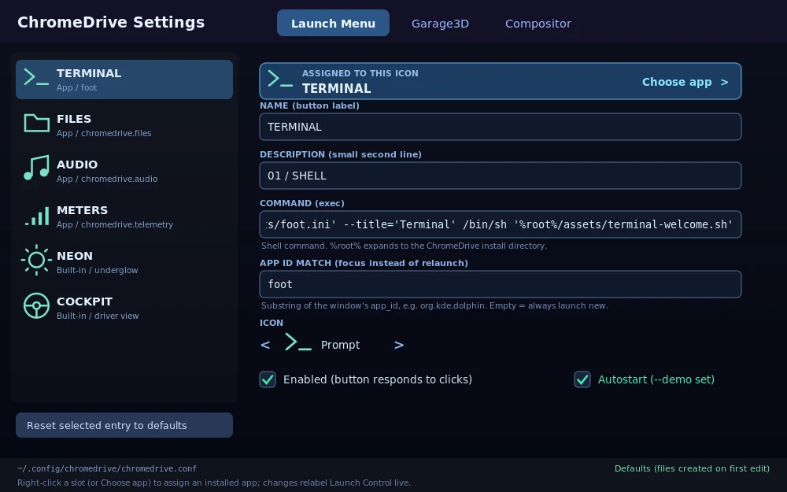
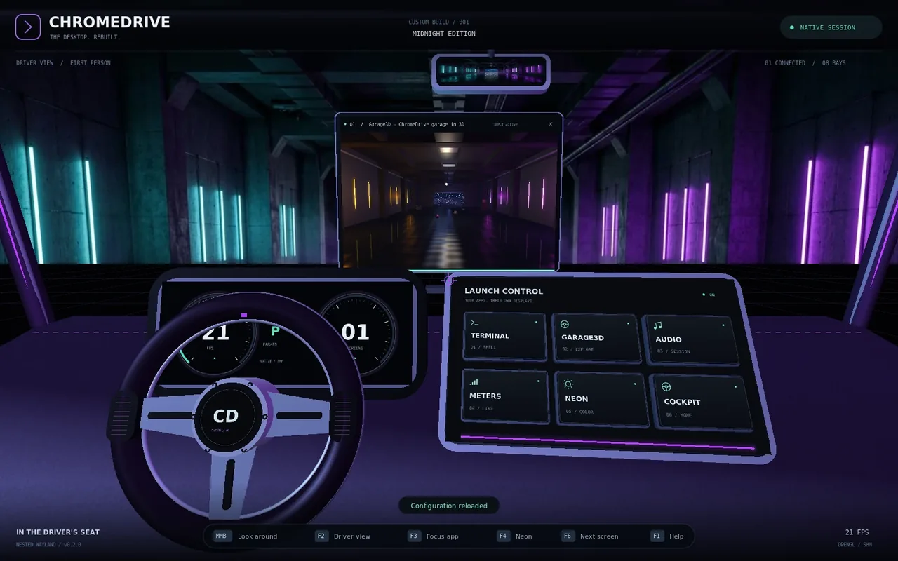
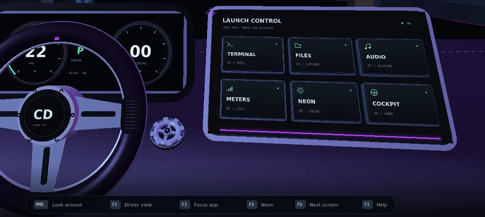
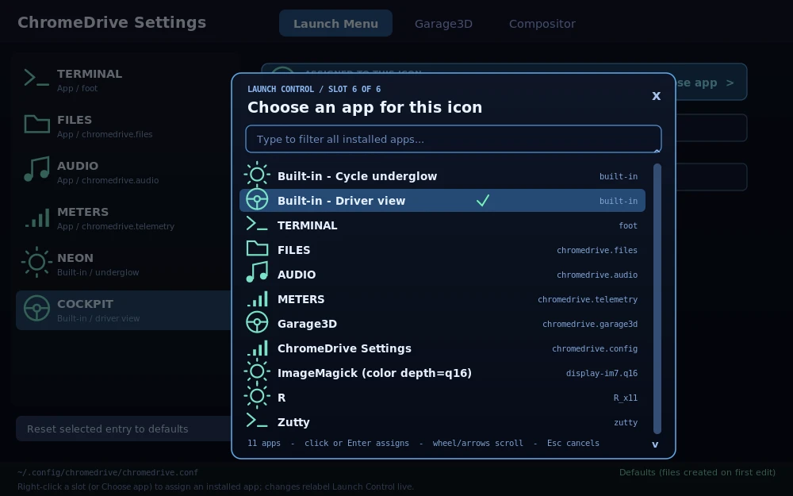

# Configuration: the launch menu, the settings GUI, and the config files

Everything user-facing in ChromeDrive and Garage3D is configurable through
**`bin/chromedrive-config`**, a native Wayland settings app, or by hand-editing
two INI files. Edits apply **live**: both programs poll their config file
every 0.5 s and hot-apply whatever changed — relabel a button in the GUI and
the cockpit's Launch Control shows the new label about half a second later.





## Running the GUI

From inside the cockpit, just **click the spinning cog on the dashboard**
(the little steel gear medallioned into the dash between the steering wheel
and Launch Control). It idles at a slow spin, brightens under the pointer,
and a click launches `chromedrive-config` onto the next free monitor — or
focuses it if it's already open. F1's Driver's Manual lists it too.

To change what a particular Launch Control tile launches, **right-click the
3D tile itself**. That opens/focuses Settings at that exact slot with the
installed-app picker already open. Right-clicks on an app's monitor still go
to that app as normal pointer input.



From a shell:

```sh
make                        # builds bin/chromedrive-config with everything else
./bin/chromedrive-config                       # on any Wayland session
WAYLAND_DISPLAY=<chromedrive-socket> ./bin/chromedrive-config   # inside ChromeDrive
./bin/chromedrive --exec "'$PWD/bin/chromedrive-config'"        # auto-launch it in the cockpit
```

Three tabs:

1. **Launch Menu** — the app-menu editor (next section). This is the main event.
2. **Garage3D** — window/camera/scene/physics of the 3D client.
3. **Compositor** — display/cockpit/session of ChromeDrive itself. The
   display backend is a restart-only enum (`headless`, `windowed`, `fbdev`, `drm`);
   the VNC port is a typed numeric field (1024–65535), not a slider: click it,
   type the exact port, press Enter; Escape cancels and invalid values are
   not saved. The fbdev/DRM device paths, exact DRM mode, and fbdev
   vsync/pan/mirror toggles are file-only (the GUI has no free-text session
   path editor).

Sliders, toggles, colour pickers and the entry list work with pointer and
touch. Text fields need a physical keyboard (there is no text-input/OSK
protocol support; on a touch-only device, edit text in the file directly).
Headless modes for scripts/CI: `--selftest` drives the real widgets against
temp config files and a temp desktop-entry fixture, then verifies the
round-trip (also part of `make test`); `--screenshot OUT.webp --tab 0|1|2`
renders a tab offscreen. `--slot N --choose-app` opens the app picker for
slot `N` (0–5), which is how the cockpit deep-links a tile right-click.

## The Launch Menu editor

The cockpit's Launch Control has six physical slots, stored in the six
`[app.*]` sections (`terminal`, `files`, `audio`, `meters`, `neon`,
`cockpit`). The section names are historical slot IDs, not fixed meanings:
**every slot can hold either an application or a built-in cockpit action**.
The defaults are apps in slots 1–4, cycle-underglow (`neon`) in slot 5, and
driver-view (`cockpit`) in slot 6. A config without an `action` key keeps
those defaults, so older files work unchanged.

### Assigning an app to an icon

Right-click a slot in the Launch Menu list, click the blue **Choose app**
bar, or right-click the corresponding 3D tile in the cockpit. The searchable
picker lists, in order:

1. the two built-in actions (*Cycle underglow* and *Driver view*);
2. the programs bundled with ChromeDrive (Terminal, Files, Audio, Meters,
   Garage3D, and ChromeDrive Settings); and
3. visible installed applications (`Type=Application`) from the desktop-entry
   databases under `$XDG_DATA_HOME/applications` and each
   `$XDG_DATA_DIRS/applications`, including subdirectories. The usual Flatpak
   and Snap export directories are also checked as fallbacks when a bare
   SSH/headless environment has no desktop-session `XDG_DATA_DIRS`.



Type to filter, scroll with the wheel or arrow keys, then click an entry or
press Enter to assign it; Escape cancels. The current assignment is marked.
Assignment writes the slot's `action`, `name`, a generated `sub`, `exec`,
`app_id`, and `icon`, and enables the slot; the cockpit relabels itself when
it hot-reloads the file.

The catalog follows normal desktop-entry precedence: a user-level file claims
its desktop ID before lower-priority system copies are considered, so a
`Hidden=true` user override (or the usual `.desktop` symlink to `/dev/null`)
masks the system app instead of letting it reappear. `NoDisplay`/`Hidden` entries and entries whose `TryExec` is missing
are omitted. `Exec` field codes such as `%U` are removed for the stored shell
command, `Terminal=true` programs are wrapped in `foot`, and a no-`Exec`
`DBusActivatable=true` entry is launched with `gio launch` when `gio` is
available. The focus-match app ID comes from `StartupWMClass` when present,
otherwise from the desktop-file ID; a cockpit glyph is inferred from the
entry's categories/name/command.

Each slot exposes the full KDE-menu-editor-style field set:

| Field (key) | Meaning |
|---|---|
| Action (`action`) | `app` = run `exec`; `neon` = cycle underglow; `cockpit` = reset the driver camera. Any action can be assigned to any slot. |
| Name (`name`) | Button label, first line. |
| Description (`sub`) | Small second line (e.g. `02 / EXPLORE`). |
| Command (`exec`) | For `action=app`: shell command run on click (via `sh -lc`). `%root%` expands to the ChromeDrive install root, so configs stay portable: `exec = %root%/clients/garage3d/bin/garage3d`. |
| App ID match (`app_id`) | For `action=app`: substring matched against a mapped window's `app_id`: clicking a running app focuses its monitor instead of launching a second copy. Empty = always launch new. |
| Icon (`icon`) | One of the six cockpit glyphs: `0` prompt, `1` folder, `2` music, `3` meters, `4` sun, `5` wheel. |
| Enabled (`enabled`) | `false` greys the button out ("DISABLED"); clicks show a notice instead of launching. Disabling a built-in assignment only disables that tile; F2/F4 still work. |
| Autostart (`autostart`) | Whether an `action=app` slot joins the `--demo` / `session.demo` launch set. |

**Adding your own app (example).** The picker writes INI like this. Here the
physical COCKPIT slot (slot 6) becomes Garage3D, slot 3 becomes Dolphin, and
slot 2 takes over the driver-view action:

```ini
[app.cockpit]
action = app
name = GARAGE3D
sub = 06 / 3D SCENE
exec = %root%/clients/garage3d/bin/garage3d
app_id = chromedrive.garage3d
icon = 5
autostart = true

[app.audio]
action = app
name = DOLPHIN
sub = 03 / FILES
exec = dolphin
app_id = org.kde.dolphin
icon = 1

[app.files]
action = cockpit
name = COCKPIT
sub = 02 / DRIVER VIEW
icon = 5
```

Notes and caveats:

- The six slots' *positions* are fixed cockpit geometry (2 rows x 3); editing
  changes everything about an entry except which physical button it is.
- `F2` always restores the driver view and `F4` always cycles the underglow,
  even if slots 5/6 have been reassigned to apps. `Ctrl+Alt+Enter` likewise
  stays “new terminal”: it looks for a terminal-like app slot even if slot 1
  now holds something else.
- `CHROMEDRIVE_TERMINAL/FILES/AUDIO/METERS` environment variables, if set,
  win over `exec` for their four historical sections (an explicit launch-time
  override from before the config file existed). The GUI warns inside the
  Command field when one is set.
- Changes are live: labels/icons regenerate immediately; a new `action`,
  `exec`, or `app_id` is used from the next click. Already-running apps are
  unaffected.

## Files, format, precedence

| App | File |
|---|---|
| Compositor | `$XDG_CONFIG_HOME/chromedrive/chromedrive.conf` (fallback `~/.config/...`) |
| Garage3D | `$XDG_CONFIG_HOME/garage3d/garage3d.conf` |

Format (both files): `[section]`, `key = value`, full-line `#`/`;` comments
(an inline `#` after a space also starts a comment; `;` is reserved for list
values such as `post_shader`), booleans as `true/false`
(`yes/no/on/off/1/0` accepted), colours as `#RRGGBB`.
The GUI saves atomically (tmp file + rename) and **preserves unknown keys**
it doesn't know about; comments/blank lines are not preserved through a GUI
save (hand-edits without the GUI are of course untouched). Missing file =
built-in defaults; malformed values are ignored with a warning on stderr,
never fatal.

Precedence, both apps: **built-in defaults < config file < environment**
(compositor `exec` only) **< command line**. `--config PATH` picks a
different file, `--no-config` ignores configuration entirely (the smoke
tests run config-isolated for the same reason). Once running, the file is
the live control surface: editing it overrides the startup state. Session
tweaks made inside the apps (F4 neon cycle, Garage3D Space pause, +/- FOV)
last until the next file edit, then the file wins for the keys it sets.
The Meta+H / dash HUD button toggle is session-only: it never writes the file,
and a later config edit hot-reloads `[cockpit] hud` back over the runtime choice.

### What's live vs restart

- **Compositor, live:** `display.fps`, `display.fov`, `display.render_to_texture`,
  `display.render_scale`, `display.render_upscale`, `display.render_downscale`,
  `display.post_shader`, `cockpit.*`
  (neon/hud/background), all `[app.*]` menu keys.
  **Restart:** `display.width/height/fullscreen`, and every `session.*` key,
  including `backend`, `headless` (legacy), `drm_device`, `drm_mode`,
  `fbdev_device`, `fbdev_vsync`, `fbdev_pan`, and `fbdev_vnc_mirror`.
- **Spatial window transforms:** titlebar/frame dragging and F6 Arrange
  position, yaw/pitch/roll, uniform scale and corner/edge resize dimensions
  are intentionally session-only. Corner/edge grips request a real new logical
  window size from the client for the current mapping; they still have no
  config keys and are not saved by the GUI. Restarting ChromeDrive, or mapping
  a new window into a bay, restores that bay's built-in monitor transform and
  the default 1000×625 request.
- **Garage3D, live:** everything except `window.width/height` (initial size).
  `window.fullscreen`/`scale` are re-requested live. Physics toggles,
  pendulum amplitude changes (energy is rescaled smoothly) and rain count
  adjust without a hitch. Edge-triggered care is taken: a reload does not
  unpause a Space-paused scene unless `physics.enabled` itself changed.

### Render scaling

The compositor can draw through an intermediate render-to-texture pass: the
3D world and cockpit are rendered at `output size x render_scale` (rounded,
minimum 1x1), then a fullscreen quad samples that texture into the real
output. The HUD, help and pointer are composited afterward at native output
resolution so their text stays sharp. That pass runs **only when
`render_to_texture` is enabled and the
effective scaled size differs from the output**; at the default
`render_scale = 1`, or with `render_to_texture = false`, rendering stays on
the direct-to-output path and the sampling keys have no effect. The one
exception is an active `display.post_shader` chain, which needs an offscreen
image and therefore forces the RTT path even at scale 1 (see below).
`render_upscale` maps to `GL_TEXTURE_MAG_FILTER`; `render_downscale`
maps to `GL_TEXTURE_MIN_FILTER`, so you can pick a different sampler for
magnifying and minifying. The default `linear_mipmap_linear` is trilinear
filtering and generates mipmaps each frame, which generally gives the cleanest
supersampled downscale. Values below 1 render fewer pixels (useful for slow
software GPUs); values above 1 supersample. Mipmap downscale tokens generate
mipmaps each frame; the others do not. SSIM is no longer a sampling token:
the optional SSIM-guided downscaler is a post effect
(`shaders/ssim-downscale.frag`), enabled with `render_scale > 1` plus
`post_shader` (see below). `render_downscale = ssim` is now an unknown value:
it is warned about and ignored, leaving the previous/default filter in place.

The configured scale is accepted from `0.001` through `100` inclusive. The
effective allocation is clamped to the driver's `GL_MAX_TEXTURE_SIZE` and
`GL_MAX_RENDERBUFFER_SIZE`; if either dimension would exceed a cap, **both**
dimensions are scaled by the same factor so the aspect ratio is preserved.
Allocation/FBO failures log a warning and fall back to the direct-to-output
path instead of black-screening. Hand-edited non-numeric, non-finite or
out-of-range values (and unknown filter names) are warned about and ignored,
keeping the previous/default setting. Pointer picking still uses output
window coordinates, and F12/`--screenshot` capture the final output at the
configured output size after the blit.

### Post shader chain

`display.post_shader` is an ordered `;`-separated list of paths to
**fragment-only GLSL 1.20** shaders applied to the 3D world only, after the
legacy filter resolve and before the native-resolution HUD. Stages run
left-to-right: the first samples the resolved world image, each later stage
samples the previous stage's output, and the last writes the real output.
Empty entries and an `off` token anywhere in the list are skipped, so a single
path without `;` works exactly as before. At most eight stages run; a longer
list logs one warning and uses the first eight. `off`, empty or missing means
no post.

```ini
render_scale = 2
post_shader = shaders/hermite-downscale.frag;shaders/khronos-pbr-neutral.frag
```

Settings > Display discovers `.frag` files in the install's `shaders/`
directory, `./shaders`, and the config directory's `chromedrive/shaders/`
(`~/.config/chromedrive/shaders/` by default). Drop a shader there to add a
checkbox without editing this file. Rows are sorted by filename, and that is
the chain order, so use `10-`/`20-` prefixes to order them. A user shader with
the same basename shadows the bundled file. Toggling writes the enabled rows
in that order, then any stored paths the scan did not find (each keeps its own
row) in their existing order. If no shader files are found at all, the four
historical relative presets are shown so the section is never empty.
"Reset tab to defaults" writes `off` and drops custom entries.

The compositor supplies the vertex shader (the post quad) and these uniforms
to every stage:

- `sampler2D u_src` — the previous stage's output at output size (texture unit
  0). For the first stage this is the resolved world image.
- `vec2 u_size` — output size in pixels.
- `float u_time` — seconds since startup (`Server.time`).
- `sampler2D u_world` — the original scaled world image at its native render
  size (texture unit 1), identical for every stage. Its configured min filter
  is left untouched, so a mipmap filter gives shaders implicit-LOD
  prefiltering; a non-mipmap filter exposes the unblurred full-resolution
  samples. Downscalers read `u_world`, so stacking two downscalers means the
  last one's `u_world` result wins; a typical chain is one downscaler plus a
  tone map.
- `vec2 u_world_size` — `u_world` size in pixels (`rtt_width`/`rtt_height`).

`gl_TexCoord[0].xy` carries the UV and the shader writes `gl_FragColor`. If a
file has no `#version` line, `#version 120` is prepended; if it has one, the
file is used as-is. Files larger than 256 KiB are rejected. Stages are
loaded/compiled lazily on the render thread when the list changes. If any
stage cannot be opened, compiled or linked, the compositor logs the per-file
warning (including the GL info log for compile/link errors), frees all stages
and renders exactly as it would without post: no black screen. The same
failing list is not retried until the config value changes.

An active chain forces the offscreen RTT path even at `render_scale = 1` (and
even if `render_to_texture = false`), because it needs an output-size source
image. This bypasses the historical direct path and its windowed-mode MSAA
only while at least one stage is loaded; once the chain is off or failed,
behavior is identical to the direct path again. With `render_scale > 1` the
world is rendered at the scaled size and resolved with the configured legacy
filter into output-size RGBA8 temporary 0. Stage 0 reads that temporary as
`u_src`; later stages ping-pong between the two temporaries; the last stage
writes the real output. If a draw fails mid-chain, the chain is disabled and
the resolved image is written straight to the output.

`shaders/khronos-pbr-neutral.frag` is a runnable example implementing Khronos
PBR Neutral tone mapping (KhronosGroup/ToneMapping, Apache-2.0). Because
ChromeDrive's world is already display-referred LDR rather than scene-linear
HDR, it acts there as a gentle highlight rolloff and framework demo, not as a
full HDR tone mapper.

`shaders/ssim-downscale.frag` is the SSIM-guided downscaler. Enable it with
`render_scale = 2` (or greater) and
`post_shader = shaders/ssim-downscale.frag`, with a mipmap
`render_downscale` filter (the default `linear_mipmap_linear`). It is adapted
from igv's SSimDownscaler (LGPL-3.0-or-later) but is a single-pass
approximation of the multi-pass original; the R ratio is smoothed once through
the 3x3 locality neighbourhood. It costs a Catmull-Rom footprint loop per
output pixel (up to 4x ratio; above that it falls back to the centre sample),
so plain trilinear supersampling is usually cheaper. At ratio <= 1 it passes
`u_src` through. The footprint uses GLSL 1.20 `texture2D` with a large
negative bias to force base-LOD samples; see the shader header for that
driver-dependent trick.

`shaders/hermite-downscale.frag` is the exact Hermite downscaler
(Mitchell-Netravali B=0, C=0, ImageMagick's "Hermite"). Use
`render_scale > 1` and `post_shader = shaders/hermite-downscale.frag` (no
mipmap filter required). It gathers every source texel in the one-output-pixel
support at LOD 0, weights it with the separable cubic and normalizes by the
weight sum (alpha included). Cost grows ~ratio^2 per output pixel; above a 4x
maximum ratio it returns the resolved `u_src`, and at ratio <= 1 it passes
`u_src` through. Compared with `ssim-downscale.frag` it is a plain resampling
filter with no contrast restoration, and cheaper at low ratios; compared with
trilinear it costs more for a sharper, less boxy footprint.

`shaders/hermite-downscale-mipmap.frag` is the mipmap-assisted approximation of
the same kernel. It needs a mipmap `render_downscale` filter (the default
`linear_mipmap_linear`) on `u_world`, uses one mip level sharper than the full
footprint as the inner prefilter, and applies the Hermite weights over a fixed
7x7 grid of that level's texels. It is fixed-cost (49 taps) with no support
cap, but the hardware box average is not an exact Hermite inner filter, so it
is an approximation rather than the reference gather. Enable it the same way
with `post_shader = shaders/hermite-downscale-mipmap.frag`; at ratio <= 1 it
passes `u_src` through. Both Hermite shaders are cheaper than the SSIM
footprint loop at high ratios, with the mipmap variant bounded regardless of
ratio.

Each `display.post_shader` entry is either a relative path (resolved from the
working directory) or an absolute path.

## Full schema

### chromedrive.conf

```ini
[display]
width = 1600          # 640..7680            (restart)
height = 1000         # 400..4320            (restart)
fps = 60              # 1..120 frame cap
fov = 65              # 1..100 driver FOV; background scroll clamps to 1..75
render_to_texture = true # gate for the scaled 3D pass; HUD stays native (live)
render_scale = 1      # 0.001..100, 1 = 100%; typed field in GUI (live)
render_upscale = linear   # nearest | linear (live)
render_downscale = linear_mipmap_linear # nearest | linear | *_mipmap_nearest | *_mipmap_linear (live)
post_shader =         # ';'-separated GLSL 1.20 chain for the 3D world, max 8; off/empty = none (live)
fullscreen = false    # --windowed only      (restart)

[ui]
language = auto       # auto | en | ru | any tag with an installed catalog (live)

[cockpit]
neon = 0              # 0 Ultraviolet, 1 Ice Blue, 2 Acid Lime
hud = true            # HUD overlay visible (Meta+H / dash HUD button at runtime)
background = 3d       # 3d | texture (flat poster) | none

[session]
backend = headless    # headless | windowed | fbdev | drm; wins over legacy headless (restart; GUI enum)
headless = true       # legacy alias, used only when backend is absent (restart)
drm_device = /dev/dri/card0  # DRM/KMS card node (restart; file-only)
drm_mode =                 # optional exact WIDTHxHEIGHT; empty = current/preferred (restart; file-only)
fbdev_device = /dev/fb0  # fbdev output path (restart; file-only)
fbdev_modeset = false      # opt-in modeset via FBIOPUT_VSCREENINFO (restart; file-only)
fbdev_mode =               # modeset target "WIDTHxHEIGHT[@BPP]" (restart; file-only; invalid value warns and disables modeset)
fbdev_vsync = true         # best-effort FBIO_WAITFORVSYNC (restart; file-only)
fbdev_pan = true           # use FBIOPAN_DISPLAY only if yres_virtual has >=2 pages (restart; file-only)
fbdev_vnc_mirror = false   # opt-in loopback-only RFB mirror/control for fbdev (restart; file-only)
fbdev_evdev = true         # enable asynchronous local evdev input for fbdev and DRM (restart; file-only)
fbdev_grab_input = false   # fbdev-only EVIOCGRAB opt-in (restart; file-only; unmanaged VT lockout warning)
drm_grab_input = true      # managed-DRM TTY input isolation (restart; file-only; no managed VT downgrades)
fbdev_input_devices =      # comma/whitespace-separated explicit device paths (max 32); replaces auto-enumeration (restart; file-only)
vnc_port = 5900       # headless VNC or fbdev mirror, 1..65535; GUI typed field 1024..65535 (restart)
vnc_loopback = true   # bind RFB to 127.0.0.1; false = 0.0.0.0 (no VNC password exists!)
demo = false          # launch autostart apps (restart)
socket =              # Wayland socket name, empty = automatic (restart; file-only)

[app.terminal]        # + app.files / app.audio / app.meters / app.neon / app.cockpit
action = app          # app | neon | cockpit; missing = per-slot default above
name = TERMINAL
sub = 01 / SHELL
exec = foot --config='%root%/assets/foot.ini' --title='Terminal' /bin/sh '%root%/assets/terminal-welcome.sh'
app_id = foot
icon = 0
enabled = true
autostart = true
```

`backend = drm` opens `drm_device` (default `/dev/dri/card0`) with DRM-master
access, selects a connected connector/compatible CRTC, and creates a GBM
`XRGB8888` EGL surface for direct KMS page-flip scanout. With `drm_mode` empty
it retains a valid current mode or selects the connector's preferred mode;
`drm_mode = "WIDTHxHEIGHT"` requires an exact advertised mode and rejects a
missing mode instead of silently choosing another. The old CRTC and its saved
connected/cloned connector set are restored on exit when still available; if
that set is stale, the original connectors are retried individually. An output
with no valid previous mode is disabled instead. A missing device, active KMS master, unsupported EGL configuration, or
unavailable output is a fatal backend-init error—there is no implicit fbdev
fallback. Use `--drm [DEVICE]`, `--drm-device PATH`, or `--drm-mode WxH` on the
command line. Actual scanout requires KMS hardware and appropriate seat/udev
access. Presentation queues at most one page flip and never waits for scanout
in the normal frame loop; a pending flip skips that output present while
Wayland clients continue on the compositor FPS clock. Bounded flip drains are
retained for VT release and shutdown so GBM/KMS buffer lifetime stays safe.

When started on a controlling Linux VT, DRM uses `VT_PROCESS` plus a main-thread
`signalfd` handshake. **Ctrl+Alt+F1…F12** from the physical evdev keyboard asks
the kernel to activate that VT; SDL and VNC input cannot activate host VTs.
Before acknowledging release, ChromeDrive stops the input worker, releases all
held input and `EVIOCGRAB` grabs, drains the old page flip, disables/retires
scanout, and drops DRM master. While inactive it pauses Wayland dispatch,
physics, GL rendering and frame callbacks. On return it acknowledges
acquisition, reacquires master (retrying if the previous master is still
leaving), discards stale evdev bytes, restarts input, and performs a fresh
initial modeset. A failed scanout drain enters cleanup instead of resuming
stale buffers. If `/dev/tty` is absent or is not a VT, managed switching is
unavailable but DRM continues; in that case `drm_grab_input = true` (the
default) is downgraded with a warning so the kernel's console chord is not
grabbed away, and TTY input isolation is explicitly unavailable. With managed
VT, a startup or resume grab failure enters cleanup instead of continuing with
partial isolation. This is controlling-VT management only, not logind/libseat
integration, and it does not set `KD_GRAPHICS`.

`backend = fbdev` adopts the mode already programmed on the framebuffer
(`var.xres`/`var.yres`) by default; `display.width/height` are ignored with a
warning because the default behavior does not call `FBIOPUT_VSCREENINFO`. With
`fbdev_modeset = true` or `fbdev_mode = "WIDTHxHEIGHT[@BPP]"` a modeset is
requested via `FBIOPUT_VSCREENINFO`; the driver may adjust timings or reject the
request. The original mode is restored on exit. Write access to the device node
is normally granted through the `video` group or a udev rule, not by running as
root. Panning is used only when the existing `yres_virtual` already has at
least two pages; vsync and pan failures degrade to a warning once. Local evdev
input (keyboard, relative/absolute pointer, multitouch type B, single-touch) is
enabled by default for both direct backends (`fbdev_evdev = true`); set
`fbdev_evdev = false` to disable. An epoll worker queues events with monotonic
kernel timestamps; only the compositor thread dispatches them to Wayland and
vehicle state. The bounded queue has a safe release barrier on overflow, and
device loss cannot leave driving controls latched.
`fbdev_grab_input = true` opts in to `EVIOCGRAB` for fbdev only. fbdev VT
switching remains unmanaged, so this retains a VT/console lockout warning
there. DRM instead uses the independent `drm_grab_input = true` default and the
managed lifecycle above; an old generated `fbdev_grab_input = false` therefore
does not disable DRM isolation. Isolation covers devices successfully opened at
startup. Hotplug is not implemented, and unreadable/omitted explicit devices or
`--no-evdev`/`--no-grab-input` remain outside that guarantee. `fbdev_input_devices`
accepts a comma/whitespace-separated list of explicit `/dev/input/event*` paths
(max 32); when set it replaces auto-enumeration of `/dev/input/event*`.
Auto-enumeration examines every event node until 32 usable devices are open;
unreadable/unsupported nodes do not consume slots, so earlier mice cannot hide
a later keyboard merely by directory order. Hybrid pointer/keyboard devices
retain both routes. Enumeration is startup-only; no hotplug rescans. Non-direct multitouch devices
(touchpads) are treated as pointer-only; raw touchpad motion is not translated
to `wl_touch`. `wl_touch` is advertised only when a direct-touch device is
present at startup. Without `fbdev_vnc_mirror` and no evdev devices opened,
fbdev is output-only; with it, RFB binds `127.0.0.1` on `vnc_port`. The headless
backend does the same by default (`vnc_loopback = true`); RFB here has no
authentication, so an all-interface bind is opt-in (`--vnc-listen-all` or
`vnc_loopback = false`) and is announced at startup. Use
`--backend headless|windowed|fbdev|drm`, `--fbdev [DEVICE]`, `--fbdev-device
PATH`, `--fbdev-modeset`, `--fbdev-mode WxH[@BPP]`, `--no-fbdev-vsync`,
`--no-fbdev-pan`, `--drm [DEVICE]`, `--drm-device PATH`, `--drm-mode WxH`, and
`--fbdev-vnc-mirror` (`--vnc-mirror`) on the command line. Generic input aliases
`--evdev`, `--no-evdev`, `--grab-input`, and `--input-device PATH` work for both
fbdev and DRM alongside the older fbdev-named options. The old
`--headless`/`--windowed` aliases still set the same enum.

### garage3d.conf

```ini
[window]
width = 1280          # initial logical size (restart)
height = 720          # (restart)
fullscreen = false
scale = 0             # 0 = follow output, 1..4 forced buffer scale

[camera]
fov = 62              # 30..90
orbit_speed = 1.0     # drag sensitivity multipliers
zoom_speed = 1.0
pan_speed = 1.0
move_speed = 6        # WASD locomotion, m/s
attract = true        # idle view drift
attract_delay = 6     # seconds idle before drift

[scene]
neon_left = #1AFFE9   # base colours; emissive = colour x neon_intensity
neon_right = #F525FF
neon_intensity = 2.5
light_intensity = 1.0 # master dimmer over all scene lights
fog_density = 0.016   # 0 disables
rain = 420            # 0..420 streaks outside the doorway
mist = 1.0
reflections = 1.0     # wet-floor reflection strength
city_density = 0.30   # lit-window fraction, near skyline layer
flicker = true        # the faulty right-wall tube

[physics]
enabled = true        # false = start (and stay, until edited) paused
gravity = 1.0         # multiplier on 9.81
lamp_swing = 18       # pendulum amplitude, degrees; 0 = hangs still
fan_speed = 1.0
balls = true
```

## Interface language

`[ui] language` selects the language of ChromeDrive's **own** chrome: the HUD,
the Driver's Manual, Launch Control labels, the transient notices, and the
settings GUI itself. It does not touch the locale of the Wayland clients you
run inside the cockpit — a compositor is not responsible for their
translations, and trying to be is how you get a half-translated desktop.

```sh
# the same thing from a shell, no config edit needed
CHROMEDRIVE_LANG=ru ./bin/chromedrive
```

`auto` follows `LC_ALL`, then `LC_MESSAGES`, then `LANG`; `C`, `POSIX` and an
unset locale all mean English. The GUI offers `auto` plus every language it
finds an installed catalog for, and switching applies immediately — the
compositor rebuilds the textures it baked text into, and the settings window
relabels itself on the next frame.

Catalogs are plain UTF-8 text at `assets/locale/<tag>.lang`, looked up in
this order (first hit wins, no merging):

1. `$CHROMEDRIVE_LOCALE_DIR`
2. `$XDG_CONFIG_HOME/chromedrive/locale` (your overrides)
3. `$XDG_DATA_HOME/chromedrive/locale`
4. `<install root>/assets/locale` (shipped)

The format is the same INI shape as the config files, keyed by the **English
source string** (the gettext model) rather than by invented identifiers:

```ini
# assets/locale/ru.lang
Launch Control = Пусковая панель
Window width = Ширина окна
```

Two consequences worth knowing:

- **English always works.** A missing catalog, a missing key, or a typo in a
  language tag falls back to the source string, so a partial translation is a
  normal, shippable state — never a screen full of blanks or key names.
- **Rewording an English string silently drops its translation.** That is the
  price of using readable text as the key. `tests/test_i18n.c` guards against
  it: `make test` fails if any key in the shipped catalog no longer appears
  verbatim in `src/` or `clients/`. Keys may not contain `=` (it separates key
  from value) and are matched exactly including case and spacing, so keep the
  doubled spaces that align the HUD's columns.

To add a language, copy `assets/locale/ru.lang`, translate the right-hand
side, and reload — no build step, no extraction tool, no code change.

## Scripts and font coverage

English, Russian, Chinese, Japanese and Korean ship today as
`assets/locale/{ru,zh,ja,ko}.lang`. Anything beyond that needs one thing checked
first, because it fails silently and looks like a rendering bug rather than a
missing dependency.

**The text path uses cairo's toy API** (`cairo_select_font_face` +
`cairo_show_text`) with the family names `DejaVu Sans` / `DejaVu Sans Mono`.
DejaVu covers Latin, Greek, Cyrillic — and nothing else. It has **no CJK, no
Arabic, no Hebrew, no Thai, no Devanagari**.

**The toy API does not fall back per glyph.** This was measured rather than
assumed: rendering `启动面板` with `DejaVu Sans` produces ink coverage
*byte-identical* to rendering it with a deliberately bogus family name
(`No Such Family 12345` → 2.583% vs `DejaVu Sans` → 2.583%), i.e. tofu boxes,
while `Noto Sans CJK SC` gives 5.774%. So a CJK catalog loaded today renders a
screen of empty boxes, not Chinese. Evidence:
`evidence/cjk-font-fallback-probe.webp`.

Two mechanisms turn that measurement into a working CJK catalog. Both exist:

1. **A catalog names its family.** `@font = Noto Sans CJK SC` (and
   `@monofont = Noto Sans Mono CJK SC`) in the catalog header are read by
   `src/i18n.c` and handed to every `cairo_select_font_face` call, at draw time
   so a language switch applies immediately. `i18n_font()` / `i18n_monofont()`
   return `NULL` when a catalog asks for nothing, and the built-in DejaVu names
   are kept. One family per catalog is enough; Noto Sans CJK also carries Latin
   and digits, so mixed chrome still renders.
2. **A startup probe refuses a catalog it cannot draw.** `src/fontprobe.c`
   renders each sampled code point into a 64×64 A8 surface and compares the
   bytes with the same rendering of an unassigned private-use code point
   (U+F8FF). Identical pixels means both became the same .notdef box — the
   family has no glyph — so the catalog is refused, the offender is reported as
   `U+XXXX` plus UTF-8 bytes, and the UI falls back to English before anything
   is baked. The whole block is skipped for English, and a failure is not
   retried on every config reload (it is retried when the requested language
   changes, so picking the language again after installing the font works).

The samples come from the loaded catalog's **values**, in first-appearance
order (`i18n_sample_glyphs()`), so the probe tests the strings that will
actually be drawn instead of a hardcoded table that can drift from them.

Result, measured on this tree:

```
$ CHROMEDRIVE_LANG=zh ./bin/chromedrive-demo files --screenshot /tmp/zh.webp
[font] zh: 12 sample glyphs covered by 'Noto Sans CJK SC'

$ # same catalog with @font = No Such Family 12345
[font] WARNING: catalog 'zh' cannot be rendered
[font]   12 sample glyph(s) missing from family 'No Such Family 12345'
[font]   first missing code point: U+6587 (UTF-8: E6 96 87)
[font]   falling back to English; install a font that covers this catalog or fix its @font directive
```

`tests/test_fontprobe.c` covers both directions (a family without the glyph is
reported uncovered, one with it is covered, the catalog's directive — not the
caller's default — decides, and English never probes). Its CJK assertions are
**skipped and counted**, not silently passed, when Noto Sans CJK is not
installed on the machine.

A catalog also has to be **complete**, and that is a test, not a convention.
The language menu lists every `.lang` under `assets/locale`, so a catalog with
gaps is a language a user can select and then read half in English; counting
`tr()` call sites says nothing about that. `tests/test_i18n.c` therefore holds
two guards that run as part of `make test`:

- **drift** — every key in every catalog must still appear verbatim in `src/`
  or `clients/`. Using English text as the lookup key means a reworded label
  silently orphans its translations, and it shows up as a stale key in each
  catalog that still carries it.
- **parity** — every catalog must define the same key set as `ru.lang`, the
  reference set. A new English label must be added everywhere in the same
  patch; a key whose translation genuinely is the English text stays listed
  with the English text as its value, because explicit beats absent.

Both guards skip cleanly (rather than failing) when the test binary runs
outside a checkout.

3. **Do not ship Arabic, Hebrew, Indic or Thai catalogs yet.** The toy API does
   no contextual shaping and no bidi: Arabic would render as isolated,
   disconnected letterforms in the wrong visual order — unreadable, and worse
   than not offering the language. `asyncinput`-style completeness aside, this
   needs a real shaping engine (Pango) before those scripts are honest to
   claim. Document any limitation explicitly rather than shipping a catalog
   that looks broken.
4. **CJK does not need shaping**, so a CJK catalog plus `@font` and the probe is
   genuinely sufficient — no Pango required. `assets/locale/zh.lang`,
   `ja.lang` and `ko.lang` ship on that basis.

### Fixed slots: shrink, then ellipsize, never clip

Both clients draw into a fixed 1000x625 surface where every string has a
neighbour: a 205 px sidebar, 230 px file cards, two 288 px gauge cards, a 302 px
label lane in front of the value controls, a 560 px popup with a name column and
an app-id column. Translated text is routinely 20-40% wider than the English it
replaces, so drawing a label without measuring it is a layout bug that only
appears in another language.

`src/textfit.c` (policy, no cairo, unit-tested by `tests/test_textfit.c`) and
`src/textfit_cairo.c` (cairo glue, shared by both clients) implement one rule:

1. measure the string; if it fits, draw it untouched;
2. otherwise scale the font down, but no smaller than a legibility floor (0.85
   in the demo clients, 0.86 in the settings GUI);
3. if it still does not fit, cut whole code points off the end and append `…`.

Clipping is never the answer, and neither is letting text run into the next
column: a cairo clip rectangle hides the end of a sentence with no hint that
anything is missing.

Both clients can render a page offscreen for exactly this check: the settings
GUI already had `--screenshot OUT.webp --tab 0|1|2`; the demo client gained
`chromedrive-demo files|audio|telemetry|cluster --screenshot OUT.webp`, which
opens no Wayland connection and needs no compositor, so a layout can be
inspected (and diffed) without a window being mounted at an angle in the 3D
scene.

`CHROMEDRIVE_TEXT_AUDIT=1` logs every string that had to be shrunk or elided,
with its slot width. `tools/check-client-overflow.sh` renders every shipped
catalog in every tab, the app picker and all four demo modes offscreen and fails
if any of them ellipsizes (`make check-text`; `make test` runs the same check in
report-only mode). The English strings are the reference layout and must render
at 100% - if English starts shrinking, a slot got narrower than the text it was
designed for.

The settings GUI sizes its tab pills from the label *as drawn*
(`cd_fit_measure`), so a longer translation shrinks inside its own pill instead
of pushing the row under the Reset button.

**The compositor's own chrome now uses the same policy.** `src/ui.c` used to
draw its baked labels with `cairo_show_text()` at a fixed size: the HUD's
control-hint bar sized its pills around the English words (`{94,98,106,…}`), so
Russian "Раскладка" was cut to "Движен…" under the next key cap, and the
windshield's centred mode line could run into the speed or pack group. Every
baked text call in `src/ui.c` and the drive-through bay signs in
`src/city_scene.c` now go through the same shrink-then-ellipsize helpers
(`text_fit`, `mono_fit`, `text_fit_c`, `oblique_fit`), with one rule for each
slot:

- a label that is the last thing on its line asks `lane(c, x, margin)` for the
  width from `x` to the surface edge — the honest budget, and it follows the
  window size (`hud()` bakes at `s->width` × `s->height`);
- a label with a column beside it passes that slot's width explicitly;
- the hint bar *measures* its nine labels and sizes the pills around them,
  instead of assuming English word lengths; only if the measured bar cannot fit
  the capsule do the labels shrink, and then all of them shrink together.

The bay signs are the one place a size was chosen from measurement rather than
guessed: at 58 px the longest English bay name measured 1073 px inside a
1024 px plate, i.e. the old code drew 49 px of it outside the sign. They bake at
52 px, where every English name fits at 100%, so a shrink there always means a
translation outgrew the sign.

**One place defines the default family.** `i18n_font_family(mono)` in
`src/i18n.c` returns the catalog's `@font`/`@monofont` when it named one and the
built-in DejaVu default otherwise; `ui_font_family()` and `cd_font()` both
delegate to it. `src/city_scene.c` used to spell `"DejaVu Sans"` itself, which
would have painted every bay sign as tofu in a CJK session. A drawing path that
names a family directly is a bug, not a style choice.

`i18n_utf8_truncate()` additionally refuses a size above `PTRDIFF_MAX`: call
sites compute budgets (`cap - used`) and an `int` that goes negative converts to
a huge `size_t`, which the copy loop would believe. `i18n_utf8_truncate_n()`
takes a signed budget for the same reason, and `tests/test_i18n.c` covers both
directions.

Two related rules are enforced in code and in `AGENTS.md`:

- **Never truncate translated text with a printf precision.** `%.62s` and
  `%.*s` count *bytes* and split multi-byte characters. Already reachable with
  Russian, certain with CJK. `i18n_utf8_truncate()` in `include/i18n.h` is the
  replacement.
- **Never `snprintf()` a translated string into a fixed buffer either.** It
  truncates on a byte count too, and the damage is worse than a mangled
  character: a half-written code point makes cairo latch
  `CAIRO_STATUS_INVALID_STRING`, and *every subsequent draw call on that
  context is silently dropped*. One over-long translation blanked the whole app
  picker below its header and the footer line - a whole-window failure from a
  96-byte note buffer. `cd_utf8_printf()` in `include/textfit.h` is the bounded,
  boundary-safe replacement, and it also sanitises text that a previous
  byte-wise truncation already broke.
- **Never translate a format string instead of its arguments.** `tr("%s")`
  with the real sentence passed as an argument translates nothing. Pass `"%s"`
  as a literal and wrap the argument in `tr()`.

DejaVu's metrics differ substantially from Noto CJK (taller ascent/descent), so
baked layouts that assume DejaVu baselines will sit low and reflow once a CJK
family is in use. Compute bake geometry from `cairo_font_extents` rather than
hardcoded offsets when the `@font` directive lands.

## Implementation notes

- `include/cdconfig.h` + `src/cdconfig.c`: the generic string-typed INI
  store (load/atomic-save/typed getters). Used by the compositor and the
  GUI. `tests/test_config.c` covers round-trips incl. unknown keys.
- `include/i18n.h` + `src/i18n.c`: the runtime translator (catalog parsing,
  language resolution, search order). Deliberately standalone like
  `cdconfig.h`, so the settings GUI links it without dragging in GL.
  `tests/test_i18n.c` covers parsing/escapes/search order/hot reload and
  includes the catalog-drift guard described above.
- Garage3D needs no store (it never writes): `clients/garage3d/src/config.c`
  is a typed loader for the same format, with every value range-clamped —
  it must stay standalone, hence the deliberate small duplication.
- The compositor applies config in `src/main.c` (`apply_config` at startup,
  `config_poll` + `apply_app_config` in the loop; `ui_refresh_buttons` in
  `src/ui.c` re-renders button textures). Garage3D applies in its `main.c`
  loop through `scene_apply_settings` plus edge-triggered diffs.
- The GUI (`clients/config.c`) is schema-driven for the slider tabs and
  hand-built for the menu editor; one `draw_ui()` builds both pixels and
  hitboxes, so `--selftest` can click real widget coordinates headlessly.
  Its installed-app catalog is loaded at GUI startup from the desktop-entry
  locations described above.
- A cockpit tile right-click deep-links the GUI in two ways. If Settings is
  not running, the compositor launches it with `--slot N --choose-app`. If it
  is already mapped, new argv cannot be delivered to that process, so the
  compositor atomically writes `<slot> <nonce>` to
  `$XDG_RUNTIME_DIR/chromedrive-config.<wayland-socket>.picker-request`
  (temp file + `rename()`); the GUI polls that socket-keyed file, ignores a
  stale request left from before it started, and consumes each nonce once.
