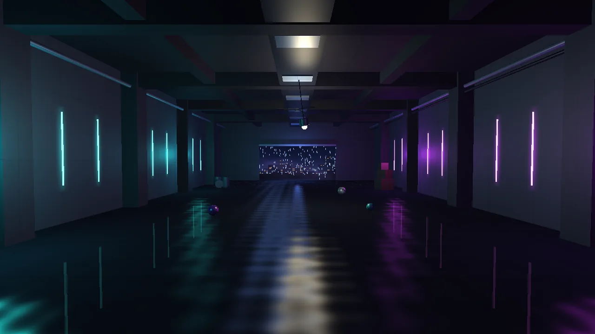
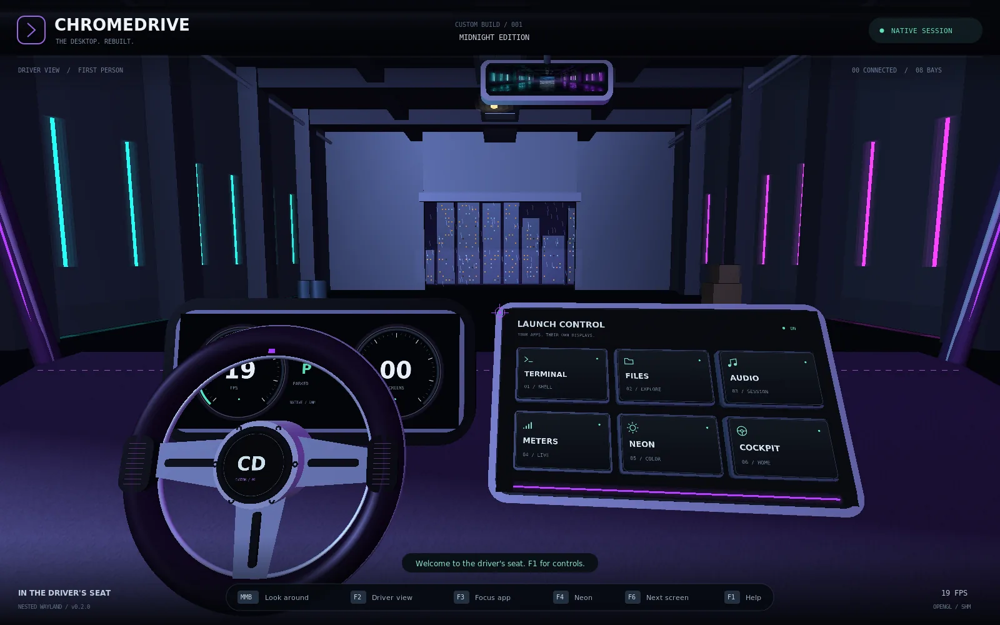
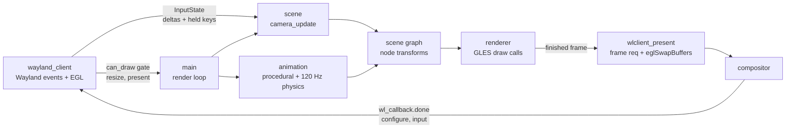

# Garage3D: the 2D garage backdrop, rebuilt as a real-time 3D Wayland client

`assets/garage.webp` (1584×672) used to be ChromeDrive's entire world beyond the
windshield: `src/scene.c:environment()` drew it as one flat 90×38.2 textured
quad at `z=-35`. This change replaces that poster with real geometry in **two**
places:

1. **`clients/garage3d/` — a new standalone native Wayland client** (the main
   deliverable). Raw `libwayland-client`, `xdg-shell`, EGL on a
   `wl_egl_window`, OpenGL ES 3.1. No SDL, GLFW, GTK or Qt. It renders the
   garage as an explorable 3D scene with a scene graph, procedural animation
   and a fixed-step physics simulation, on any Wayland compositor — weston,
   sway, GNOME/Mutter, KDE/KWin, phosh, **and ChromeDrive itself**.
2. **`src/scene.c:environment()` — the compositor's own background** is now the
   same hall built from boxes/cylinders in the compositor's existing
   immediate-mode style, so the cockpit has correct parallax when the driver
   looks around. `garage.webp` remains only as the tiny rear-view-mirror
   reflection, as an homage.





---

## 1. Build and run (step by step)

### 1.1 System packages

Debian/Ubuntu (this is the exact set the code was built and tested with,
Debian 13 “trixie”, Mesa 25.0.7):

```sh
sudo apt-get install -y \
  build-essential pkg-config \
  libwayland-dev wayland-protocols \
  libegl-dev libgles-dev libgles2-mesa-dev mesa-common-dev \
  libxkbcommon-dev libwebp-dev
# optional, only for `make smoke` (end-to-end render test):
sudo apt-get install -y weston python3-pil
```

What each one is for:

| Package | Provides | Used by |
|---|---|---|
| `libwayland-dev` | `wayland-client`, `wayland-egl` (the `wl_egl_window` API) and `wayland-cursor` headers/pkg-config modules, `wayland-scanner` | `wayland_client.c`, protocol generation, cursor theme |
| `wayland-protocols` | `stable/xdg-shell/xdg-shell.xml` | generated `xdg-shell-client.h` / `xdg-shell-protocol.c` |
| `libegl-dev` | `egl` module, `EGL/egl.h`, `EGL/eglext.h` | EGL display/config/context/surface |
| `libgles-dev` | `GLES3/gl31.h` (on trixie; other distros ship it in `libgles2-mesa-dev`) | `renderer.c` |
| `libwebp-dev` | `WebPEncodeRGBA()` for `--screenshot` (WebP is the repo's only image format, see `AGENTS.md`) | `main.c` |
| `libgles2-mesa-dev` | `glesv2` module / `-lGLESv2`, which exports the ES 3.x entry points | linking |
| `mesa-common-dev` | remaining Mesa GL/EGL headers | both programs |
| `libxkbcommon-dev` | `xkbcommon` module | compositor-supplied keyboard keymaps |

Fedora equivalents: `wayland-devel wayland-protocols-devel mesa-libEGL-devel
mesa-libGLES-devel libxkbcommon-devel`. Arch: `wayland wayland-protocols mesa
libxkbcommon`. The ChromeDrive compositor itself additionally needs
`libsdl2-dev libcairo2-dev libdrm-dev libvncserver-dev foot` (see the root
[`README.md`](../README.md)).

### 1.2 Build

```sh
# from the repository root
make -j"$(nproc)"        # the compositor (unchanged target)
make garage3d            # -> clients/garage3d/bin/garage3d
make garage3d-test       # headless unit tests (no compositor/GPU needed)

# or standalone
make -C clients/garage3d
make -C clients/garage3d test     # math / meshes / scene graph / physics
make -C clients/garage3d smoke    # renders under weston/headless, checks pixels
make -C clients/garage3d sanitize # ASan+UBSan build
sudo make -C clients/garage3d install   # binary + shaders to /usr/local
```

`garage3d` is intentionally **not** part of the root `make all`: building the
compositor should not require the client's GLES3/cursor dependencies.

Shader files are loaded from disk at runtime, searched in this order:
`--shader-dir`, `$GARAGE3D_SHADER_DIR`, `<exe>/shaders`,
`<exe>/../shaders` (the dev-tree layout: binary in `bin/`, shaders in
`shaders/`), `<exe>/../share/garage3d/shaders` (the installed layout),
`./shaders`, `./clients/garage3d/shaders`, then `/usr/local/share` and
`/usr/share`. The binary therefore works from any working directory — a
compositor launching it does not control its cwd.

### 1.3 Run

On your desktop session (any compositor):

```sh
./clients/garage3d/bin/garage3d
./clients/garage3d/bin/garage3d --width 1600 --height 900 --fov 55 --fullscreen
```

Inside ChromeDrive itself — it appears as an app on one of the eight virtual
monitors, at ChromeDrive's configured 1000×625 surface size:

```sh
./bin/chromedrive --demo                 # note the socket it prints
WAYLAND_DISPLAY=<printed-socket> ./clients/garage3d/bin/garage3d
# or in one go:
./bin/chromedrive --exec "$PWD/clients/garage3d/bin/garage3d"
```

Headless smoke test (no display, works over SSH/CI):

```sh
make -C clients/garage3d smoke
# standalone equivalent:
./clients/garage3d/bin/garage3d --frames 60 \
    --screenshot /tmp/garage.webp --screenshot-frame 45   # under any compositor
```

### 1.4 Controls

| Input | Action |
|---|---|
| Left-drag / one-finger drag | Orbit (with a short inertial glide) |
| Right- or middle-drag / two-finger drag | Pan |
| Wheel / pinch | Zoom (orbit distance) |
| Double-tap / `R` | Reset to the mockup framing |
| `W A S D` + `Q E` (or arrows + PgUp/PgDn) | Move the orbit target through the hall |
| `+` / `-` | Field of view (also `--fov 30..90`) |
| `Space` | Pause/resume animation + physics |
| `F` | Toggle fullscreen (asks the compositor; it decides) |
| `Esc` / `Ctrl+Q` | Quit |

After 6 s without input the camera breathes a few degrees (“attract mode”), as
a display-only offset that never disturbs the user's own yaw/pitch.

Command-line: `--width/--height`, `--scale 1..4`, `--fov`, `--fullscreen`,
`--shader-dir`, `--paused`, `--frames N`, `--exit-after SECONDS`,
`--screenshot PATH.webp --screenshot-frame N`, `--help`.

---

## 2. Architecture

Clean module separation was a hard requirement. Only **one** file knows the
Wayland protocol, only **one** knows GL object lifetimes, and the scene /
animation / math modules are pure C with no GL or Wayland includes (which is
exactly why they unit-test headlessly).

```
clients/garage3d/
├── Makefile                  build, test, smoke, sanitize, install
├── README.md                 quick start
├── shaders/                  all GLSL, loaded from disk (10 files)
│   ├── lit.vert / lit.frag       Blinn-Phong: 1 dir + 6 point lights, fog
│   ├── neon.vert / neon.frag     emissive tubes, halos, bulb, reflections
│   ├── city.vert / city.frag     procedural rainy skyline (hash windows)
│   ├── mist.vert / mist.frag     doorway haze (animated sine field)
│   └── particle.vert/.frag       rain streaks (GL_LINES)
├── src/
│   ├── main.c                CLI, signals, render loop orchestration
│   ├── wayland_client.{h,c}  PLATFORM: wl_display/registry/xdg-shell,
│   │                         wl_egl_window + EGL, frame callbacks,
│   │                         pointer/keyboard(xkb)/touch, cursor, dispatch
│   ├── input.h               InputState: the platform <-> scene contract
│   ├── renderer.{h,c}        GL: shader programs, mesh VAOs, draw order,
│   │                         rain streaming buffer (context made current
│   │                         by the platform module; never presents)
│   ├── scene.{h,c}           scene graph, garage construction, camera,
│   │                         lights, materials (pure CPU, no GL)
│   ├── animation.{h,c}       procedural tracks + fixed-step physics
│   ├── mesh.{h,c}            procedural unit meshes (box/planes/cyl/sphere)
│   └── gmath.{h,c}           Vec3 / Quat / column-major Mat4
├── tests/test_gmath_physics.c  unit tests for the pure modules
└── tools/smoke-test.sh         weston/headless end-to-end pixel check
```

Data flow per frame:



Dependency direction is strictly one-way: `scene`/`animation` include only
`gmath`/`mesh`/`input`; `renderer` includes `scene`/`animation`; the platform
includes only `input` from the app side. Nothing outside `wayland_client.c`
includes `<wayland-client.h>`; nothing outside `renderer.c` calls GL to build
objects (the platform owns only `EGLDisplay/Config/Context/Surface`, the
renderer owns programs/VAOs/buffers inside that context).

### 2.1 From the 2D mockup to the 3D scene

| `garage.webp` | Garage3D (client, `scene.c`) | Compositor port (`src/scene.c`) |
|---|---|---|
| Concrete hangar, one-point perspective down a centre aisle | 22 m × 8.5 m × 45 m hall; default camera on the centre line at (0, 3, 10) looking to (0, 2.5, −9) | 30 m × 13.5 m × 46 m hall around the car; eye at (0, 1, 2.8) |
| Cyan vertical neon tubes, left wall | 8 emissive cylinders + additive halo quads under 4 per-bay parent nodes | `glow_line()` tubes, two per bay |
| Magenta/violet tubes, right wall | Mirrored; the split lighting comes from 4 cluster point lights | Mirrored; existing teal/violet fixed-function lights |
| Protruding pillars, panelled walls | Box pillars every 8 m; panel seams are procedural in `lit.frag` (3 m grid, `fwidth` anti-aliased) | Box pillars + shallow wall panels |
| Coffered ceiling, beams, ducts, pipes | Transverse/longitudinal beams, central duct + vents, 3 pipe cylinders, spinning ceiling fan | Same elements as boxes/cylinders |
| Wet reflective floor with neon streaks | Dark glossy floor (α=0.86) drawn **over mirrored neon tubes** under the floor + rippled specular (see §3.3) | Dark floor slab + additive per-tube reflection streaks |
| Far opening to a rainy night city | Hole in the far wall (3 boxes around an aperture), procedural city shader, 420 rain-streak physics particles, 4 drifting mist sheets | Far wall with opening, deterministic box skyline + point windows, 130 rain lines, 2 mist quads |
| Moody purple fog | Exponential fog in `lit.frag` toward `#0B0B1A`-ish violet | Fixed-function `GL_EXP2` fog scoped to `environment()` |
| — (added life, kept out of the aisle) | Swinging work lamp (pendulum physics + the dynamic point light *is* the bulb), 3 bouncing/rolling balls, one flickering tube, crates/barrels | Lamp on a closed-form swing, one flickering tube, barrels/crates |

### 2.2 Scene graph, camera, lights

* Flat node array (≤320 nodes, 122 built). A parent always precedes its
  children, so world matrices resolve in one forward pass:
  `world = parent_world * T * R(quaternion) * S`. Children inherit scale —
  `scene.c` deliberately parents the lamp bulb to the *pivot*, not to the
  cable, because a child of the cable (Y-scale 3) would inherit a 3× stretch.
* Perspective camera: configurable FOV (30–90°, default 62°), near 0.1 m, far
  220 m. Orbit target + distance, exponentially damped angular velocity
  (`1-exp(-k·dt)`, frame-rate independent), eye clamped inside the hall box
  as cheap collision.
* Lights: **one directional** (cool city-night glow travelling into the hall
  through the opening) and **six point lights** in a shader uniform array —
  four neon clusters (16 physical tubes would be 16 lights; on mobile that
  budget is better spent elsewhere, and clusters are visually indistinct),
  the swinging lamp, and a cool doorway spill. Attenuation is
  `I / (1 + 0.08d + 0.08d²)`; the quadratic term is what stops teal light
  from reaching the magenta wall. Diffuse is albedo-tinted, Blinn-Phong
  specular is not (a near-black wet floor must still throw a bright streak).
  There are no shadow maps: six shadow-casting points would need a cube-map
  pass each; the mockup's look doesn't depend on cast shadows, and the frame
  budget is better spent on the 60 fps target.
* Materials are textureless. Concrete detail, city windows, mist and neon
  halos are all procedural in shaders — the client ships zero image assets.

### 2.3 Draw order (why the floor looks wet without an FBO)

`renderer.c` draws in four layers: **opaque** → **mirrored neon under the
floor** (additive, no depth write) → **the floor itself** (alpha-blended,
α=0.86, depth write on) → **halos/mist** (additive, no depth write) → rain.
The mirrored tubes seen *through* the 14%-transparent floor read as a planar
reflection, at the cost of 16 extra cylinder draws instead of a reflection
render-target pass (which on tile-based mobile GPUs means a full extra scene
render plus a resolve). The rippled specular in `lit.frag` smears on top.

---

## 3. Animation and physics

Two kinds of motion, kept apart on purpose:

**Procedural (analytic `f(t)`, exact at any frame rate):** ceiling-fan spin
(140°/s), healthy-neon breathing (`0.96 + 0.04 sin 7t`), the faulty tube's
12 Hz hash-bucket flicker (its cluster point light follows), mist drift
(analytic sines around authored anchors), city-window twinkle and floor
ripples (shader-side, driven by `u_time` = simulated time, so `Space` freezes
them too).

**Physics (integrated, fixed-step):** semi-implicit Euler at a **fixed
120 Hz**, fed by an accumulator from real delta-time (clamped to 0.1 s per
rendered frame; at most 24 catch-up ticks, then time is dropped — no spiral
of death). Fixed-step is what makes the simulation identical at 30/60/120 Hz
presentation. Three systems:

* **Hanging-lamp pendulum** — `θ̈ = −(g/L)·sinθ − c·θ̇`, `L=3 m` (the cable
  length in the graph), two axes; semi-implicit Euler is symplectic, so it
  doesn't gain energy over thousands of swings. A pseudo-random “breeze”
  impulse every 8–13 s re-energises it. The lamp's point light reads its
  world position back out of the bulb node's matrix each frame.
* **Balls** — gravity, floor bounce with restitution 0.72 (settling below
  0.85 m/s impact to avoid micro-bounce), wall bounds, rolling friction, and
  rolling rotation `axis = up × v`, `angle = |v|·h/r`, accumulated as
  quaternions; a latitude band in `lit.frag` makes the rotation visible. A
  fully stopped ball is relaunched from above the aisle.
* **Rain** — 420 streaks at terminal velocity with a slight wind slant in a
  volume **outside** the doorway (`z < −30`), respawning at the top; the
  renderer expands each into a velocity-aligned `GL_LINES` segment and
  streams it with `glBufferSubData` (points would need `gl_PointSize`, whose
  cap varies wildly across mobile GPUs, and round sprites don't read as rain).

Camera motion is also state-based and `dt`-scaled: held keys give 6 m/s
regardless of the compositor's key-repeat rate, and orbit deltas are
accumulated per frame rather than applied per event (a 1000 Hz mouse must not
orbit faster than a 60 Hz touchpad).

---

## 4. Wayland surface lifecycle and the render loop

This section is the protocol contract `wayland_client.c` implements. The
ordering constraints in **bold** are the ones that produce fatal protocol
errors when violated.

### 4.1 Startup sequence

1. `wl_display_connect(NULL)` — uses `$WAYLAND_DISPLAY`, else
   `$XDG_RUNTIME_DIR/wayland-0`. This is also how the client finds
   ChromeDrive: point `WAYLAND_DISPLAY` at its printed socket.
2. `wl_display_get_registry` + one `wl_display_roundtrip`, so every global
   has been seen before acting on it. Bind `wl_compositor` ≤v4, `wl_shm` v1
   (cursor theme), `xdg_wm_base` ≤v3, `wl_seat` ≤v7, `wl_output` ≤v2 — the
   minimum of “what we use” and “what the compositor offers”. Capping keeps
   every receivable event inside the listener callbacks actually implemented
   (and 3/7 are exactly ChromeDrive's versions). Missing `xdg_wm_base` is
   fatal with a clear message; a missing `wl_seat` only warns (headless
   weston has no input devices — attract mode still looks right).
3. Build the role stack: `wl_compositor_create_surface` →
   `xdg_wm_base_get_xdg_surface` → `xdg_surface_get_toplevel`. Set **title,
   app_id, min-size and the initial fullscreen request before the first
   commit** — they are initial state.
4. **Initial empty commit: `wl_surface_commit` with no buffer attached.** Its
   only job is to make the compositor emit the first
   `xdg_toplevel.configure` + `xdg_surface.configure(serial)`. Attaching a
   buffer before this is `xdg_surface.unconfigured_buffer` — a fatal error
   (ChromeDrive's server enforces it too: `src/wayland.c:surface_commit`).
5. In the `xdg_surface.configure` handler, **`xdg_surface_ack_configure(serial)`
   first**, record state, nothing else — no EGL calls from inside libwayland's
   dispatch. `xdg_toplevel.configure` is only a *suggestion* batched ahead of
   that commit point: store `w/h` (0 means “you choose”) and the states array
   (fullscreen is compositor-confirmed here, never assumed from our request),
   but do not resize or ack there.
6. **Only now** create the native window at the configured size:
   `wl_egl_window_create(surface, phys_w, phys_h)`, then EGL:
   `eglGetPlatformDisplayEXT(EGL_PLATFORM_WAYLAND_KHR, wl_display)` (falling
   back to `eglGetDisplay`), `eglInitialize`, `eglBindAPI(EGL_OPENGL_ES_API)`,
   `eglChooseConfig` (RGBA8 + depth24 + `EGL_OPENGL_ES3_BIT`, no MSAA),
   `eglCreateContext` for **ES 3.1, falling back to 3.0** (all features used
   are core 3.0, so the same binary runs on older mobile drivers),
   `eglCreatePlatformWindowSurfaceEXT`, `eglMakeCurrent`,
   `eglSwapInterval(1)`. If the current output's scale > 1,
   `wl_surface_set_buffer_scale` is set once here so the very first buffer is
   already at physical resolution.
7. `frame_ready = true` (nothing is outstanding), and the main loop starts.

Why EGL/`wl_egl_window` rather than hand-rolled dmabuf sharing? With Mesa's
Wayland EGL platform, buffer allocation and the `linux-dmabuf` vs `wl_shm`
negotiation happen inside the driver: on a GPU with a render node the client
gets zero-copy dmabuf buffers that ChromeDrive imports via its real
`EGL_LINUX_DMA_BUF_EXT` path (`src/dmabuf.c`); without `/dev/dri` (this
sandbox) Mesa falls back to shm/swrast and the same binary still works. A
Vulkan/dmabuf-by-hand path would re-implement exactly that negotiation for no
user-visible gain.

### 4.2 The frame-callback render loop

```c
while (running) {
    dispatch(timeout = can_draw ? 0 : -1);  // events; block only when idle
    handle edge requests (fullscreen / pause / quit);
    if (!can_draw) continue;                // <-- the vsync gate
    apply_pending_resize();                 // wl_egl_window_resize, deferred
    dt = clamp(now - previous, 0, 0.1);
    camera_update(dt);  anim_update(dt);  scene_update_world();
    renderer_draw();                        // GL only; no Wayland here
    present();                              // frame request, then swap
}
```

* **`can_draw` = configured ∧ no frame callback outstanding ∧ size > 0.**
  `present()` requests `wl_surface_frame` and **then** calls
  `eglSwapBuffers`. Order matters: `wl_surface.frame` is double-buffered
  surface state, flushed as part of the swap's attach+commit (EGL-on-Wayland
  does the `attach`/`damage`/`commit` internally — the client must **not**
  attach or commit manually in this mode). Requesting before the swap makes
  the callback observe the frame just presented; requesting after would
  attach it to some future commit and can stall the loop a frame. The
  callback is destroyed in its `done` handler (it is single-shot) and sets
  `frame_ready`.
* **This is the entire 60 fps throttle.** There is no timer and no sleep:
  with a callback outstanding, dispatch blocks in `poll()` at 0 % CPU until
  the compositor presents. If the window is occluded and the compositor
  withholds callbacks, the client simply sleeps. `eglSwapInterval(1)` is kept
  as a backstop, but frame callbacks are what avoid the extra buffer of
  latency a swap-interval-only loop pipelines.
* **Dispatch is the race-free single-threaded pattern:**
  `while (wl_display_prepare_read()) dispatch_pending; flush; poll(fd);
  read_events | cancel_read; dispatch_pending`. Skipping `prepare_read`
  (e.g. “check queue, then `poll`”) loses the race where events land between
  the check and the sleep, stalling a frame until the *next* event. Flushing
  **before** sleeping is equally load-bearing: the `ack_configure` that
  unblocks the next frame must reach the compositor before we wait for it.
  `EINTR` returns to `main`, whose `sigaction` is installed **without**
  `SA_RESTART` so `Ctrl-C` actually interrupts the `poll`.
* **Delta-time** comes from `CLOCK_MONOTONIC`, never from Wayland event
  timestamps (compositor clock, undefined base — `frame.done`'s time is kept
  only as diagnostics). `dt` is clamped to 0.1 s so an occluded window
  doesn't fast-forward physics on its next frame.

### 4.3 Resize, scale, fullscreen

* A resize is **deferred**: `xdg_surface.configure` sets `resize_pending`; the
  main loop then calls `wl_egl_window_resize` (+ `wl_surface_set_buffer_scale`
  if the scale changed) between dispatch and drawing. Doing EGL work inside
  the configure callback would re-enter driver code from inside libwayland's
  dispatch loop. Neither the EGL surface nor the context is recreated — Mesa
  reallocates backing buffers lazily on the next swap, and all GL objects
  survive.
* Sizes: xdg configures speak in **logical** pixels; the EGL window and
  `glViewport` use **physical** pixels (`logical × buffer_scale`, integer
  scales only — no `wp_viewporter`/fractional-scale yet). The desired scale
  follows `wl_surface.enter` + `wl_output.scale`, or `--scale`. Pointer and
  touch coordinates arrive in logical pixels, so camera sensitivity is
  scale-invariant for free. On a compositor with `wl_surface` < v3 (no
  `set_buffer_scale` request), the client forces scale 1 rather than emitting
  a request the server can't parse.
* Fullscreen (`F`) is a **request**: `xdg_toplevel_set_fullscreen` /
  `unset_fullscreen`; the local `fullscreen` flag is written only from the
  states array of the next `toplevel.configure`.

### 4.4 Input (`wl_seat`)

Devices are created/destroyed **as capabilities appear/disappear**
(`wl_seat.capabilities`) — a keyboard plugged in after startup works, one
unplugged doesn't leak a proxy. Release uses `wl_*_release` only where the
proxy version actually has that request.

* **Pointer:** enter sets a real cursor (wayland-cursor theme over `wl_shm` —
  in Wayland the pointer image is undefined until the client sets one;
  ChromeDrive draws its own reticle and ignores the surface, which is fine).
  Motion/axis accumulate and commit on `wl_pointer.frame` (v5+ atomic
  grouping; applied per-event on older seats). Scroll prefers
  `axis_discrete` over the continuous `axis` value when both arrive — they
  describe the same motion, and adding both is the classic double-zoom bug.
* **Keyboard:** the keymap fd from `wl_keyboard.keymap` is mmap'd and parsed
  with `xkb_keymap_new_from_buffer` (not `_from_string`: don't trust a NUL
  terminator), and **closed on every path**. xkb keycodes are `evdev + 8`.
  Modifier state is mirrored from `wl_keyboard.modifiers`, never tracked from
  raw Shift presses. `enter` re-syncs the held-key bitmap from its keys
  array; `leave` clears it (no stuck flying after Alt-Tab). Movement reads
  *held state* each frame, so `repeat_info` is deliberately unused — a text
  client would need a timer there, a 3D client must not tie speed to the
  repeat rate. One-shot commands use keysyms (labels), WASD uses physical
  evdev positions (same hand position on AZERTY/Dvorak).
* **Touch (mobile):** `wl_touch` with up to 10 contacts. Gestures are computed
  in `wl_touch.frame` — contacts arrive as one atomic group terminated by
  `frame`, and a pinch computed from half-updated contacts saw-tooths.
  1 finger = orbit, 2-finger centroid = pan, pinch log-ratio = zoom,
  double-tap = reset. On a 2→1 finger transition the remaining finger is
  re-baselined (the standard anti-jump). `cancel` drops all contacts.
  **ChromeDrive caveat:** the *compositor* never advertises
  `WL_SEAT_CAPABILITY_TOUCH` (`bind_seat` in `src/wayland.c` sends
  pointer|keyboard only, `seat_touch` exists but stores no resources, and
  neither the VNC nor SDL backend synthesises touch). So inside ChromeDrive
  the client is driven by pointer/keyboard like every other app; on touch
  compositors (phosh, sway, GNOME on a touchscreen) the full gesture set
  works. Forwarding touch through ChromeDrive is future compositor work:
  advertise the capability, keep a `wl_touch` resource list, route
  `server_touch_*` through `scene_pick`'s monitor planes, and feed it from
  `SDL_FINGERDOWN/MOTION/UP` in `backend_sdl.c` (VNC/RFB has no multitouch).

### 4.5 Configuration and hot-reload

All tunables are `GarageSettings` (`src/config.h`): window size/scale/
fullscreen, camera (FOV, sensitivities, attract), scene (neon base colours
and HDR gain, light dimmer, fog, rain, mist, reflections, city density,
faulty-tube flicker) and physics (gravity, lamp amplitude, fan speed, balls).
`src/config.c` is a small typed loader for the project INI format
(`~/.config/garage3d/garage3d.conf`); precedence is defaults < file < CLI
(`--config`/`--no-config` aside), implemented as a pre-scan that seeds the
CLI option struct *before* argument parsing. The scene owns a copy of the
effective settings, so animation/renderer/camera read them without extra
plumbing parameters.

The render loop polls the file's mtime at 2 Hz (an extra branch beside the
edge-triggered input handling in §4.2 — no inotify thread needed for a
single small file the GUI writes atomically). On change,
`scene_apply_settings()` re-tints every neon node (nodes carry a
`color_role` tag from build time), recolours the cluster lights and updates
fog/FOV/mist/ball visibility; edge-triggered consequences are diffed in
`main` first (rain population via `anim_set_rain_count`, physics pause,
pendulum energy rescale, `wlclient_set_fullscreen` /
`wlclient_set_scale_override`) so a reload can't clobber a Space-pause.
The writer side is the project settings GUI (`bin/chromedrive-config`);
the full schema for both config files is `docs/configuration.md`.

### 4.6 Shutdown order

`xdg_toplevel.close`, `Esc`/`Ctrl+Q`, or SIGINT/SIGTERM all funnel into a
clean exit. `main` calls `renderer_shutdown` **first** (GL objects must die
while the context is current), then `wlclient_shutdown` unwinds in reverse
dependency order: outstanding frame callback → unbind current →
`eglDestroySurface` → `eglDestroyContext` → **`wl_egl_window_destroy` after
the EGL surface that renders into it** → `eglTerminate` → cursor surface/theme
→ pointer/keyboard/touch/seat/outputs → **`xdg_toplevel_destroy` before
`xdg_surface_destroy` before `wl_surface_destroy`** (destroying a surface with
a live role is a protocol error) → xkb state/keymap/context → registry →
`wl_display_flush` + `wl_display_disconnect`.

---

## 5. Verification performed

All in this sandbox (llvmpipe, no `/dev/dri` — so fps numbers are the software
rasteriser's, not a GPU's; the frame-callback loop targets the output's
refresh, 60 fps on a 60 Hz output with any real Mesa GPU driver):

| Check | Command | Result |
|---|---|---|
| Baseline + new compositor build | `make -j` (root) | clean, `-Wall -Wextra`, no warnings |
| Client build | `make -C clients/garage3d` | clean, no warnings |
| Existing compositor tests | `make test` (root) | PASS (raycast/picking) |
| Client unit tests | `make -C clients/garage3d test` | PASS (projection/look-at/quaternions, mesh bounds, graph ordering, 10 s of pendulum/ball/rain physics, accumulator) |
| Client under **weston 14 headless** | `make -C clients/garage3d smoke`, manual 90-frame run | ES 3.1 context created (Mesa reports ES 3.2), 122 nodes, screenshot pixel checks pass (both neon colours present, ~12 % bright px, 0.1 % clipped); 17 fps under llvmpipe at 1280×720 |
| Client under **ChromeDrive headless** | `WAYLAND_DISPLAY=garage-in-cd …/garage3d --frames 45 --screenshot …` | adopted ChromeDrive's configured **1000×625** size; server log: `mapped Garage3D [chromedrive.garage3d] -> CD-01 (1000x625)`; clean exit 0 |
| Compositor with 3D backdrop | `./bin/chromedrive --headless --screenshot … --exit-after 8` | PNG captured (above); 19 fps under llvmpipe at 1600×1000 |
| No-compositor error path | `WAYLAND_DISPLAY=definitely-not-a-socket ./garage3d --frames 1` | clear diagnostic, exit 1 |

Worth knowing when reading the smoke test: an early screenshot came back
all-black because the capture used `glReadPixels(GL_RGB, …)` — a format GLES
does **not** guarantee for readback, which fails silently on several Mesa
drivers. The capture now reads `GL_RGBA` (the one guaranteed pair) and checks
`glGetError`. The first correctly-exposed render then exposed a real tuning
bug (point intensities of 55–90 with that attenuation curve white out the
hall, and specular was incorrectly albedo-scaled); both are fixed and the
reasoning is commented at the light definitions in `scene.c`/`lit.frag`.

### Troubleshooting

| Symptom | Likely cause |
|---|---|
| `wl_display_connect failed` | No compositor on `$WAYLAND_DISPLAY`, or wrong `$XDG_RUNTIME_DIR` (for ChromeDrive, use the socket it prints) |
| `shader '…' not found` | Moved binary without its shaders: use `make install`, `--shader-dir`, or `$GARAGE3D_SHADER_DIR` |
| `no suitable EGL config` / context failure | Driver without GLES 3.0+ window configs (very old Mesa); check `eglinfo` / `es2_info` |
| Window opens but never draws | Compositor withholds frame callbacks while occluded — by design; unminimise/focus it |
| Blurry on a HiDPI phone, sharp at `--scale 2` | Output advertises scale 1 host-side; force with `--scale` |
| No touch inside ChromeDrive | Expected today — see the ChromeDrive caveat in §4.4 |

### Known limitations / next steps

* No fractional scaling (`wp_fractional_scale_v1` + `wp_viewporter`); integer
  buffer scales 1–4 only.
* No `xdg-decoration` negotiation: the client asks for no decorations and
  accepts whatever the compositor does by default (content is full-bleed 3D).
* No shadow maps, no MSAA, no text/HUD overlay — deliberate 60 fps/mobile
  budget calls, documented at the point of decision in the code.
* The compositor-side garage is a fixed-function port (closed-form lamp
  swing, point-sprite windows, no physics balls/fan) — visual parity, not
  simulation parity. The full simulation lives in the client.
* ChromeDrive touch forwarding (server-side) as described in §4.4.
